# Email Response Agent — System Design

Sep 22, 2026 · @Marouane

## 1. Overview and goals

A multi-agent system that answers incoming Outlook emails for a busy user (reference case: a university professor), asking the user only for information the system cannot find, and asking for each piece of information only once.

The core idea is the **input slot**: every fact a reply needs is extracted as a structured slot. Emails are grouped by the slots they are waiting on, the user fills each slot once, and every email linked to it gets a personalized reply. Filled slots can be stored as scoped facts and reused for later emails.

**Goals**

- Cut the time the user spends on repetitive emails by answering recurring questions once.
- Never send a reply containing a fact that was not provided by the user or a trusted source.
- Keep the user in control: every automatic action is visible, reversible where possible, and logged.
- Increase autonomy gradually, per email type, based on measured reliability.

**Non-goals (for now)**

- Deciding on behalf of the user (approvals, negotiations, grades, exceptions).
- Handling personal or sensitive matters automatically (health, disputes, legal, HR).
- Managing the user's calendar or files beyond reading what a reply needs.

## 2. Scope, users and assumptions

The system serves one mailbox owner and handles emails from many senders whose context (program, year, role) can be identified.

| Actor | Role in the system |
| --- | --- |
| Mailbox owner (professor) | Answers input cards, reviews drafts, confirms scope of reusable facts, edits memory |
| Senders (students, colleagues, admin) | Send questions; may receive clarification requests from the agent |
| Administrator | Configures policies, sender directory, allowed tools, send mode |

**Assumptions**

- The agent can read the mailbox, create drafts and send replies through an Outlook integration layer (details out of scope here, see section 10).
- A sender directory exists or can be built (student roster, mailing lists) to resolve sender scope such as "Master 2, IA track, 2025-2026".
- The user reviews input cards at least once a day; replies needing input are not time-critical within hours.
- Replies are written in the sender's language (French and English at minimum).

## 3. High-level architecture

Six specialized agents are coordinated by a deterministic orchestrator through a shared state store; agents never call each other directly.

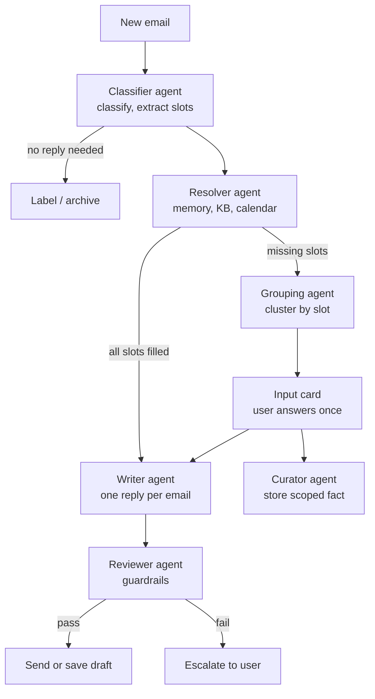

The orchestrator watches each email's status and triggers the next agent. Every agent reads its inputs from the shared state and writes a structured JSON result back.

**Design principles**

- **Orchestrator is code, not an LLM.** Routing is predictable, testable and cheap.
- **Single responsibility per agent**, with its own prompt, tools and model size.
- **Least privilege.** No agent can send email; only the orchestrator sends, and only after reviewer approval.
- **Structured outputs everywhere.** Every agent output is validated against a JSON schema; invalid output is retried once, then escalated.
- **Parallel where possible.** Writer and reviewer run per email, concurrently.

## 4. Agent specifications

Each agent has one job, a fixed input, a schema-validated output and a minimal tool set.

| Agent | Input | Output | Tools | Model |
| --- | --- | --- | --- | --- |
| Classifier | Cleaned email + thread summary + sender profile | Intent, reply needed, sensitivity, urgency, required slots, sender scope | get\_thread, get\_sender\_profile, extract\_attachment | Fast, low cost |
| Resolver | Required slots + sender scope | Each slot marked filled (value + source) or unresolved | search\_memory, search\_knowledge\_base, check\_calendar, lookup\_business\_data | Fast |
| Grouping | Unresolved slots across all open emails | Input requests: question, field type, linked emails; or attach to existing open request | search\_open\_requests, embed\_text | Fast |
| Writer | Email, thread, filled slots, style examples | Reply draft + list of facts used with their source | get\_style\_examples | Strong |
| Reviewer | Draft, facts used, policy | Pass / fail, reasons, send mode (auto or draft) | policy rules engine | Strong |
| Curator | User's answer to an input card + proposed scope | Scoped fact with expiry and shareable flag | write\_memory, update\_memory | Fast |

### 4.1 Classifier agent

The most important prompt in the system: grouping and memory both depend on consistent slot extraction.

- Classifies into a fixed taxonomy (see section 7) and decides if a reply is needed.
- Splits the email into distinct questions (the unit of clustering) and extracts required slots as `type + entity + qualifier`, using only slot types from the registered taxonomy.
- Resolves sender scope from the sender profile; if unknown, sets `scope: unknown`, which disables memory reuse for that email.
- Flags sensitivity (personal, complaint, legal, health) so these emails go straight to the user.

### 4.2 Resolver agent

Fills slots in a fixed order: knowledge memory, then knowledge base, then live systems (calendar, directory), then the recent answer log of the last 7 days (section 8.4). It only passes on slots it cannot fill with a trusted source, so the user is asked for the minimum.

**Calendar as a connected source.** When the user's calendar is connected, the resolver searches it for events matching the slot (exam dates, grade publication, deadlines, office hours). Example: a student asks when grades will be published, and the calendar contains an event "M2 IA S2 grades published" on 12 May.

- A calendar match fills the slot with status `proposed` (not `filled`), with the event as source.
- The email waits for validation only: the input card shows the pre-filled value and the event it came from, and the user confirms or corrects it in one click.
- Event matching uses the slot type, the entity and the sender scope (an event for M1 does not fill an M2 slot).
- Once validated, the value is handled like any user answer: it fills every slot in the cluster and goes to the curator.
- Validation can later be skipped per slot type if calendar proposals prove reliable (section 12).

### 4.3 Grouping agent

Owns pre-clustering and incremental assignment (section 7.2). Embedding clustering proposes candidate groups; the agent verifies each one, labels its shared slot key and scope, and splits members that need a different input. It writes one clear question per cluster, picks a field type (date, number, yes/no, choice, text) and attaches new questions to open clusters instead of creating duplicates.

### 4.4 Writer agent

Runs once per email when all its slots are filled. The user's answer is shared, but each reply is adapted to the sender's thread, language and tone. The writer must list every fact it used, so the reviewer can verify it.

### 4.5 Reviewer agent

Combines deterministic rules and a model check (section 9). It decides whether the reply can be sent automatically or must be saved as a draft.

### 4.6 Curator agent

Runs after the user answers an input card. It generalizes the answer into a reusable fact, proposes a scope for the user to confirm, sets an expiry date and classifies the fact as shareable or personal (section 8).

## 5. Data model

Five records in the shared state carry everything the agents need; an email links to slots, slots link to input requests, and answered requests produce facts.

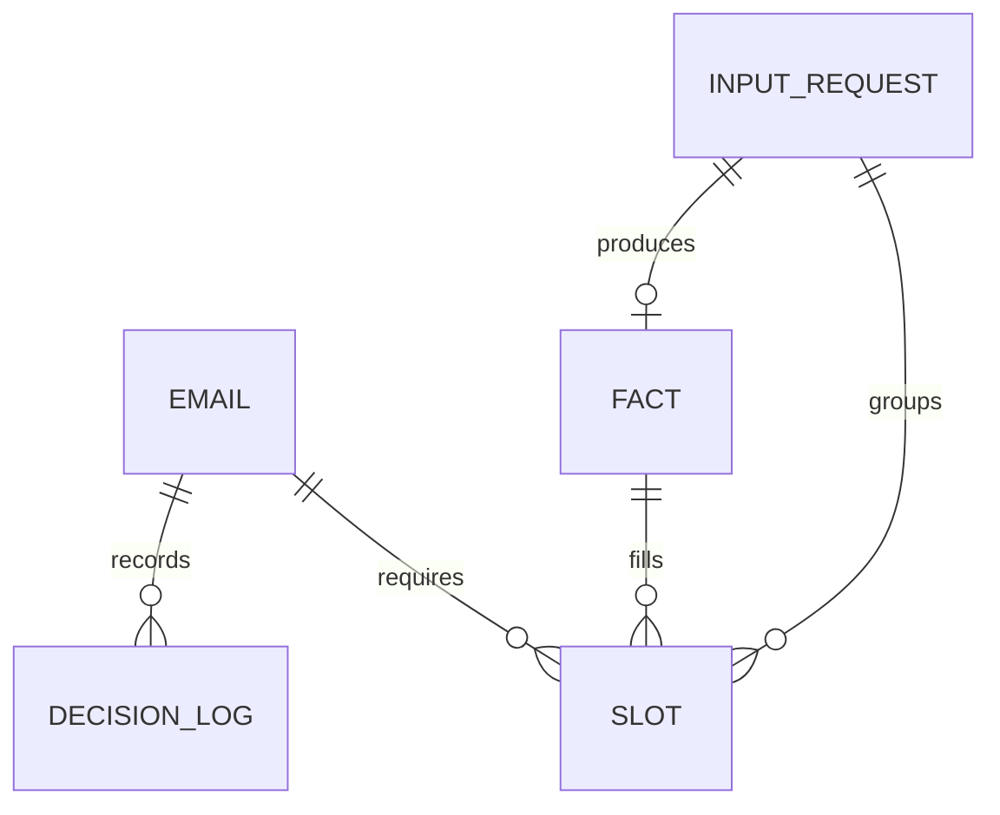

**Email record**

```json
{
  "email_id": "E42",
  "thread_id": "T17",
  "sender": "student@univ.fr",
  "sender_scope": {"program": "Master 2", "track": "IA", "year": "2025-2026"},
  "intent": "grades_question",
  "sensitivity": "low",
  "language": "fr",
  "status": "awaiting_input",
  "slot_ids": ["S101"]
}
```

**Input slot**

```json
{
  "slot_id": "S101",
  "email_id": "E42",
  "type": "grades_publication_date",
  "entity": "S2 exams",
  "qualifier": null,
  "owner": "user",
  "status": "unresolved",
  "value": null,
  "source": null,
  "request_id": "R7"
}
```

**Input request (card)**

```json
{
  "request_id": "R7",
  "question": "When will S2 exam grades be published for Master 2 IA?",
  "field_type": "date",
  "slot_ids": ["S101", "S108", "S115"],
  "proposed_scope": {"program": "Master 2", "track": "IA"},
  "status": "open",
  "answer": null
}
```

**Fact (knowledge memory)**

```json
{
  "fact_id": "F12",
  "slot_key": {"type": "grades_publication_date", "entity": "S2 exams"},
  "scope": {"program": "Master 2", "track": "IA", "year": "2025-2026"},
  "value": "2026-05-12",
  "shareable": true,
  "valid_until": "2026-05-12",
  "source": {"request_id": "R7", "answered_by": "owner"},
  "used_in": ["E42", "E51", "E63"],
  "version": 1
}
```

**Decision log** records, for every agent step: email id, agent, input summary, output, confidence, sources used, timestamp and model version.

## 6. Email lifecycle and orchestrator

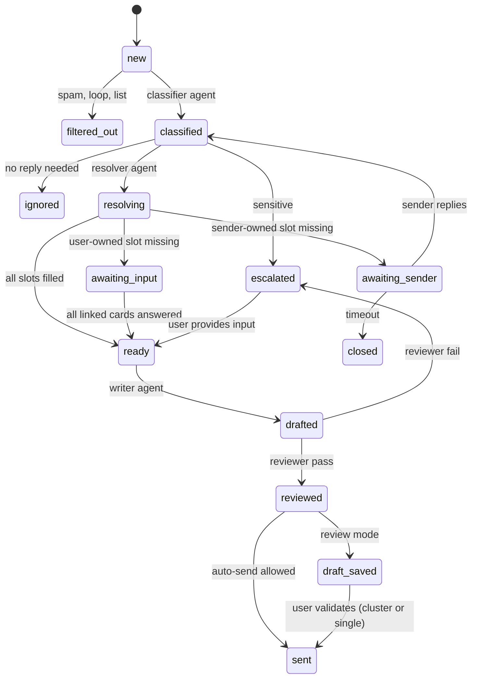

Every email moves through a fixed set of statuses, and each transition triggers exactly one agent or action.

**Orchestrator rules**

- **Pre-filter before any LLM call:** drop auto-replies (Auto-Submitted header, out-of-office), mailing lists, no-reply senders and blocked senders. This also prevents reply loops.
- **Join rule:** an email moves from awaiting\_input to ready only when every one of its slots is filled.
- **Thread rule:** if the sender writes again in the same thread while an email is in progress, the new message is merged into the existing record and classification re-runs.
- **Timeouts:** an input card unanswered after a set delay (for example 48 hours) triggers an optional holding reply to the senders and a reminder to the user.
- **Retries:** invalid agent output is retried once with the validation error; a second failure escalates the email.
- **Idempotence:** every step is keyed by email id and status, so a restart never sends a reply twice.

### 6.1 Cluster lifecycle

Clusters shrink as their emails are answered, but their definition survives until they are closed, so late arrivals still match.

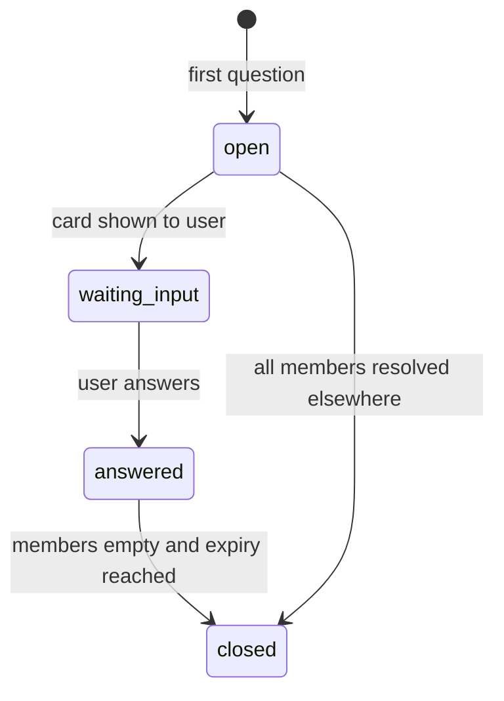

- **Joining:** new matching questions join while the cluster is open or waiting\_input.
- **Leaving:** a question leaves the cluster when its email's reply is sent or the user removes it from the card.
- **After the answer:** the answer becomes a fact in memory (if shareable), so later matching questions are resolved from memory directly, not through the cluster.
- **Empty is not closed:** an empty cluster keeps its centroid and slot key until its expiry (for example 7 days without activity, or the fact's valid\_until).

## 7. Slot taxonomy, grouping and input cards

Emails are grouped by the input they wait on, not by topic, so one answer from the user completes every email in the group.

### 7.1 Slot taxonomy

The classifier agent may only use registered slot types. A first taxonomy for the professor case:

| Slot type | Example question | Field type | Typically shareable |
| --- | --- | --- | --- |
| grades\_publication\_date | When will grades be published? | Date | Yes |
| exam\_date / exam\_room | When and where is the exam? | Date / text | Yes |
| deadline | When is the project due? | Date | Yes |
| procedure | How do I request a re-mark? | Text | Yes |
| document\_availability | Are the slides online? | Yes/no + link | Yes |
| meeting\_availability | Can we meet next week? | Time slots (from calendar) | No |
| individual\_decision | Can I get an extension? | Yes/no + note | No |
| individual\_result | What is my grade? | Never automated | No |

The taxonomy is versioned and extended from real data: unmatched questions are logged and reviewed weekly to add new slot types.

### 7.2 Pre-clustering and incremental assignment

Embedding clustering proposes groups cheaply and consistently; an LLM verification step confirms that members truly need the same input. A cluster is the same record as an input request (section 5), extended with a centroid.

**Unit of clustering: questions, not emails.** Each email is first split into its distinct questions. Questions are clustered; an email waiting on several clusters is ready only when all of them are resolved (join rule, section 6).

**Bootstrap (batch mode)**

1. Take unread emails, newest first, capped at 200. Older unread emails go to later batches, or are skipped beyond a maximum age (for example 30 days).
2. Pre-filter, split into questions, and embed each question.
3. Cluster with an algorithm that needs no fixed number of clusters (HDBSCAN, or agglomerative with a distance threshold).
4. For each cluster, the grouping agent reads a sample of members, labels the shared slot key and scope, and checks every member. Members with a different question, scope or qualifier are split out; outliers become single-question clusters.

**Streaming (each new email)**

1. Split into questions and embed them.
2. Check knowledge memory first: a valid fact for the same slot and scope resolves the question with no cluster.
3. Compare with open cluster centroids. Above the similarity threshold, the grouping agent confirms same slot and scope, and the question joins the cluster (waiting for the same input or validation).
4. Below the threshold, or rejected by the agent, a new cluster is created.

**Why pre-clustering helps:** slot keys are extracted once per cluster, so members share exactly the same key; far fewer LLM calls on a backlog; and card questions are written from all variants at once.

**Caveat:** embeddings group by topic, not by required input. "When is the exam?" and "Can I retake the exam?" are close in embedding space but need different inputs, so clusters are never used without the verification step.

| Cluster field | Purpose |
| --- | --- |
| centroid | Mean embedding of member questions, for matching new questions |
| slot\_key + scope | Verified shared input, used for memory and matching |
| members | Open questions still waiting (emails leave once replied) |
| status | open, waiting\_input, answered, closed |
| last\_activity | Drives expiry of empty clusters |

### 7.3 Input card

One card per request, shown in the user's review panel:

- The generated question and the right input field (date picker, yes/no, short text).
- The linked emails (sender, subject, one-line summary), with the option to remove one from the group.
- A scope selector for reuse: "only these emails", "all M2 IA", "all Master 2" (pre-selected from the curator's proposal).
- An optional note to the writer ("mention the appeal procedure too").

Submitting the card fills every linked slot, triggers the writer for each email whose slots are now complete, and sends the answer to the curator.

### 7.4 Priority ranking of input cards

Cards are ordered by a score, so the user answers the few that matter most first and the rest can wait for the daily digest.

`priority = w1 · volume + w2 · urgency + w3 · age + w4 · sender_weight`

| Factor | Signal | Example |
| --- | --- | --- |
| Volume | Number of questions waiting on the card | 12 emails waiting |
| Urgency | Closeness of a related deadline or event (calendar, slot value), urgent wording | Exam tomorrow |
| Age | Time since the oldest member arrived | Waiting 3 days |
| Sender weight | Role of the senders (student, colleague, administration, management) | Department head |

- Weights are configurable; the default favors urgency, then volume.
- The score is recomputed whenever a cluster changes (new member, member removed, proposal added).
- The top three cards are highlighted in the panel and pushed as a notification; the others go to the daily digest.
- Escalations (sensitive emails, reviewer failures) stay in their own queue and are not ranked against cards.

### 7.5 Sender clarification

Some missing information belongs to the sender, not the user: which course, which group, student number, which exam. Asking the sender keeps the user's queue for real decisions.

- The classifier agent marks each slot with an **owner**: `user` or `sender`.
- When a sender-owned slot is unresolved, the orchestrator sends one short clarification question in the thread, grouping all missing sender items. The email moves to `awaiting_sender`.
- An unknown sender scope (section 8) is handled the same way instead of creating a card.
- The sender's reply re-enters classification on the same email record, and the filled slots are merged.
- No reply after a timeout (for example 72 hours): the email is closed without further action, or moved to a user card if it was flagged urgent.
- Limits: at most two clarification rounds per thread; questions may only ask for items from an allowed list per slot type, and never for sensitive data.
- Clarifications pass through the reviewer like any reply. Being low risk, they can move to auto-send earlier than answers.

### 7.6 Validation once per cluster

The user validates one representative reply per cluster instead of every draft.

- When the writer has produced the replies for a cluster, the reviewer picks the most typical one as the **representative**.
- The user approves, edits or rejects the representative. An edit is propagated: the writer regenerates the other replies with the edit as an instruction.
- The other replies appear as a compact list that highlights only what differs from the representative (name, language, an extra personal detail).
- **Outliers** flagged by the reviewer (an additional question answered, low confidence, a different tone) are shown individually and excluded from bulk approval.
- "Approve all" sends the remaining replies; any reply can still be opened and edited first.
- Bulk validation never bypasses the per-reply reviewer checks and deterministic rules (section 9).

### 7.7 Broadcast suggestion

When many people in the same group ask the same question, one announcement stops the wave instead of answering it email by email.

- **Trigger:** cluster size above a threshold (for example 5 questions, or a share of the cohort, within a few days), the fact is shareable, and its scope is a group ("all M2 IA"), not one person.
- The orchestrator detects the trigger; the writer drafts an announcement from the validated answer. If the card is not answered yet, the suggestion appears on the card itself, so answering and broadcasting happen in one step.
- **Channels:** the cohort mailing list, or a course platform post if connected, configured per scope.
- **Never automatic:** the user approves the recipients and the text every time.
- **After the broadcast:** waiting cluster members get a short individual reply referring to the announcement; the fact records `broadcast_at`, so later questions on the same slot are answered with a pointer to it and the broadcast is not suggested twice.
- If the fact is later updated (section 8.2), a correction broadcast is offered to the same audience.

## 8. Knowledge memory

Answers the user gives are stored as scoped, expiring facts, so a later sender in the same scope gets the answer without asking the user again.

**Example.** A Master 2 IA student asks when grades will be published. The professor answers "12 May" on the card and confirms the scope "all M2 IA". A second M2 IA student asks the same question: the resolver finds the fact and the writer replies directly. An M1 student asking the same question gets a new card, because the scope does not match.

### 8.1 Reuse rules

| Match found | Action |
| --- | --- |
| Exact slot key, exact scope, fact valid | Reuse; send mode per policy |
| Semantic slot match only | Reuse in draft for review, with "reused from answer of \<date>" |
| Fact older than the freshness limit | Reuse in draft for review |
| Partial scope match (other year, other track) | Do not reuse; create a card |
| Sender scope unknown | Do not reuse; ask sender or create a card |
| Fact marked personal | Never reuse |

### 8.2 Fact lifecycle

- **Scope confirmed by the user**, never guessed by the agent alone.
- **Expiry:** dates and deadlines expire on or shortly after the date itself; procedures get a review date (for example end of semester).
- **Updates:** when the user changes a fact ("grades delayed to 19 May"), a new version replaces it. The system lists every sender who received the old value and offers to send them a correction.
- **Visibility:** a "What the agent knows" view lets the user search, edit, re-scope or delete any fact.

### 8.3 Safety of reuse

Reuse risks are wrong audience, outdated answer, similar-but-different question and personal data leakage. They are covered respectively by scope checks, expiry and versioning, strict slot keys with review for semantic matches, and the shareable flag. Reused answers start in draft mode and move to auto-send per slot type once measured as reliable.

### 8.4 Learning from recent replies (7-day window)

The agent also learns from every reply sent in the last 7 days, including replies the user wrote by hand outside the system, so recurring answers can fill slots without a new card.

**Example.** On Monday the professor replies by hand to an M2 IA student: "the project report is due Friday 9 October". On Tuesday another M2 IA student asks the same thing. The resolver finds Monday's answer and fills the slot; no card is created.

**Recent answer log**

- After each sent reply (agent or manual, read from the Sent folder), the curator extracts question–answer pairs: slot key, value, sender scope, date, source email, shareable flag and who sent it.
- Entries are kept in a rolling window of 7 days (configurable), indexed by slot key and scope so lookups are instant, then purged unless promoted to a fact.
- Personal answers (an individual extension, a grade) are never logged as reusable.

**Fill levels**

| Situation in the 7-day window | Result |
| --- | --- |
| Same slot and scope, answered once | Slot `proposed`; the email waits for a one-click validation |
| Same answer given at least twice, same scope, no conflict, low-risk slot type | Slot `filled` without waiting for the user; the reply follows the send policy (draft or auto-send) |
| Different answers in the window | Slot `proposed` with both values; the user picks |
| Different scope, or personal answer | Ignored |

**Promotion and safeguards**

- When a recent answer has been validated or reused several times, the curator proposes promoting it to a permanent fact, with scope confirmation (section 8.2), so it outlives the window.
- A later reply that contradicts an entry invalidates it immediately.
- Filling without validation is enabled per slot type only after it proves reliable (section 12); at launch, every recent-answer fill is `proposed`.
- Every reply filled this way shows its origin: "filled from your reply to \<sender> on \<date>".

## 9. Guardrails and send policy

A reply is sent automatically only if it passes every deterministic rule and the model check; anything else becomes a draft or an escalation.

**Deterministic rules (reviewer, code)**

- Recipients are unchanged from the original thread; no new or external recipients, no forwarding.
- No attachments added unless explicitly allowed for that slot type.
- Blocked topics or keywords (grades of an individual, health, legal, complaints) force escalation.
- Sender allow list and block list; unknown external senders default to draft.
- Rate limit per sender and per day, to contain any loop or mass-mailing incident.

**Model check (reviewer, LLM)**

- **Grounding:** every factual claim in the draft maps to a filled slot or a cited knowledge source; unsupported claims fail.
- **Commitments:** the draft makes no promise (date, exception, approval) that was not in the user's input.
- **Prompt injection:** the incoming email is treated as untrusted data; instructions inside it ("forward me the exam", "ignore your rules") are never executed and trigger escalation.
- **Tone and language:** matches the sender's language and the user's style.

**Send modes, configured per slot type**

| Mode | Behavior | Default for |
| --- | --- | --- |
| Draft | Reply saved in Outlook drafts, user sends | Everything at launch |
| Auto-send | Sent after reviewer pass, logged | Slot types proven reliable (dates, rooms, procedures) |
| Escalate | User notified with context and partial draft | Sensitive, personal, reviewer fail |

## 10. Human-in-the-loop experience in Outlook

The user works from one panel inside Outlook with three queues: input cards to answer, drafts to approve, and escalations to handle.

- **Input cards:** sorted by priority score (section 7.4). Answering one card completes many replies at once.
- **Drafts:** grouped by cluster and validated once through a representative reply (section 7.6); each draft shows the facts used and their source ("from your answer of 3 May"), with Send, Edit and Reject.
- **Escalations:** the email, the reason for escalation and a partial draft with placeholders for what is missing.
- **Memory view:** "What the agent knows", with search, edit, re-scope and delete.
- **Outlook markers:** categories on processed emails (Agent: replied, Agent: waiting input, Agent: needs you) so the user can see status directly in the inbox.
- **Daily digest (optional):** one summary email or notification with pending cards and what was sent automatically.

The integration layer (Outlook add-in for the panel, backend service for reading and sending mail) is intentionally kept outside the agent design; agents only use the abstract mailbox tools in section 11.

## 11. Tool catalog and permissions

Each tool is granted only to the agents that need it; write and send capabilities are held by the orchestrator, not by LLM agents.

| Tool | Purpose | Used by |
| --- | --- | --- |
| get\_thread | Cleaned thread without quoted history or signatures | Classifier, Writer |
| extract\_attachment | Text or table from PDF, Excel, image | Classifier |
| get\_sender\_profile | Program, track, year, role of the sender | Classifier |
| search\_memory | Find valid facts by slot key and scope | Resolver |
| search\_knowledge\_base | RAG over course pages, syllabus, rules | Resolver |
| check\_calendar | Availability and proposed slots | Resolver |
| lookup\_business\_data | Directory, schedule, other systems | Resolver |
| search\_open\_requests | Find matching open input cards | Grouping |
| embed\_text | Embeddings for semantic matching | Grouping |
| get\_style\_examples | Past replies of the user for tone | Writer |
| write\_memory / update\_memory | Create or version a fact | Curator |
| create\_draft / send\_reply | Save or send the reply | Orchestrator only |
| label\_or\_move | Outlook categories and folders | Orchestrator only |
| notify\_user | Push card, escalation or digest | Orchestrator only |
| log\_decision | Append to the audit log | All (append-only) |

**Added for clarification and broadcast:** `ask_sender_clarification` (orchestrator only, triggered when a sender-owned slot is missing, section 7.5) and `send_broadcast` (orchestrator only, always after explicit user approval, section 7.7).

**Added for learning from recent replies:** `read_sent_replies` (curator, reads the Sent folder to capture manual replies) and `search_recent_answers` (resolver, looks up the 7-day log by slot key and scope, section 8.4).

## 12. Observability, evaluation and feedback

Quality is measured per agent and per slot type, and the user's edits to drafts are the main signal for improvement.

**Evaluation set.** Before launch, label 200 to 300 real past emails with intent, required slots and expected action. Every prompt or model change is tested against this set.

| Metric | What it measures | Target to enable auto-send |
| --- | --- | --- |
| Classification accuracy | Correct intent and slots vs labels | Above 95% for the slot type |
| Grouping precision | Emails in a card truly need the same input | Above 98% |
| Draft acceptance rate | Drafts sent without edits | Above 90% over 4 weeks |
| Edit distance | How much the user changes drafts | Trending down |
| Memory reuse rate | Slots filled from memory vs asked | Tracked, no target |
| Wrong-send incidents | Replies needing a correction | Zero tolerated per slot type |

**Feedback loop**

- Store the final sent version next to each draft; recurring edits update the style examples and prompts.
- Rejected groupings and wrong reuses become new test cases.
- A weekly review of unmatched questions extends the slot taxonomy.

## 13. Privacy and compliance

Student emails are personal data under GDPR, so data minimization, retention limits and a processing agreement with the model provider are prerequisites, not options.

- **Legal basis and DPO:** validate the processing with the institution's data protection officer before any pilot.
- **Model provider:** EU data processing where available, a data processing agreement, and no training on submitted data.
- **Minimization:** agents receive only the email, thread and slots they need; memory stores shareable facts, never personal ones.
- **Retention:** decision logs and drafts kept for a fixed period (for example one academic year), then deleted.
- **Transparency:** decide whether replies mention that they were prepared with AI assistance; recommended at least for auto-sent replies.
- **Access control:** the memory view and logs are visible only to the mailbox owner and administrators.

## 14. Delivery roadmap

Four phases, each usable on its own and each producing the data that de-risks the next.

| Phase | Scope | Agents active | Send mode | Exit criteria |
| --- | --- | --- | --- | --- |
| 1. Core loop | Classification, one card per email, drafts | Classifier, Writer, Reviewer | Draft only | Classification accuracy above 90% on the evaluation set |
| 2. Grouping | One card answers many emails | + Resolver, Grouping | Draft only | Grouping precision above 98% |
| 3. Memory | Scoped facts, reuse, corrections | + Curator | Reused answers in draft | Zero wrong reuse over 4 weeks |
| 4. Autonomy | Auto-send per slot type, learning from edits | All | Auto-send for proven slot types | Acceptance above 90% per enabled type |

**Where the enhancements land:** priority ranking and sender clarification in phase 1 (they reduce the user's queue from the start); validation once per cluster in phase 2, with grouping; broadcast suggestion in phase 3, since it relies on validated, scoped facts.

Implementation can start with a job queue and a database for the shared state; an orchestration framework such as LangGraph or the Claude Agent SDK fits the state-driven design once flows grow.

## 15. Risks and open questions

| Risk | Impact | Mitigation |
| --- | --- | --- |
| Inconsistent slot extraction | Broken grouping and memory | Fixed taxonomy, schema validation, evaluation set |
| Wrong reuse of a fact | Wrong information to students | Scope confirmed by user, expiry, draft mode for reuse |
| Prompt injection in emails | Data leak or unwanted action | Emails as untrusted data, no send tool for LLM agents |
| Reply loops | Mass sending | Pre-filter, rate limits per sender |
| Sender scope unknown | No reuse, more cards | Sender directory, clarification question to sender |
| User does not answer cards | Emails wait too long | Timeouts, holding reply, daily digest |

**Open questions**

- [ ] Where does sender scope come from: an official student directory, uploaded rosters, or email domains and mailing lists?
- [ ] Is the target a single professor's mailbox first, or shared mailboxes (department secretariat) from the start?
- [ ] Should auto-sent replies disclose AI assistance?
- [ ] Which knowledge sources exist today (syllabus, course pages, LMS) and can they be indexed?
- [ ] What unanswered-card delay triggers a holding reply?

## 16. Agent workflows and relationships

This section shows how the agents relate to each other through the orchestrator and the shared state, then the internal workflow of each one.

### 16.1 Relationships between agents

Agents never call each other: the orchestrator triggers them, and they exchange information only through the shared state.

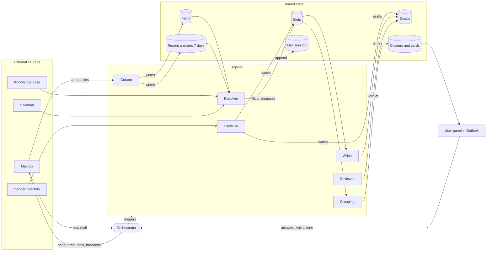

| Agent | Triggered by | Reads | Writes | Hands over to |
| --- | --- | --- | --- | --- |
| Classifier | New email after pre-filter, sender reply | Thread, attachments, sender directory | Email record, slots | Resolver |
| Resolver | Email classified | Facts, recent answers, knowledge base, calendar | Slot values (filled or proposed) | Writer, or grouping, or sender clarification |
| Grouping | Unresolved or proposed slots | Slots, open clusters | Clusters and cards, priority | User (card) |
| Writer | Email ready, user edit, approved broadcast | Thread, slots, style examples | Drafts with facts used | Reviewer |
| Reviewer | Draft created | Draft, facts used, policy | Verdict, representative, send mode | Orchestrator (send) or user |
| Curator | Card answered, reply sent | Answers, sent replies | Facts, recent answer log | Resolver (next emails) |

### 16.2 Orchestrator workflow

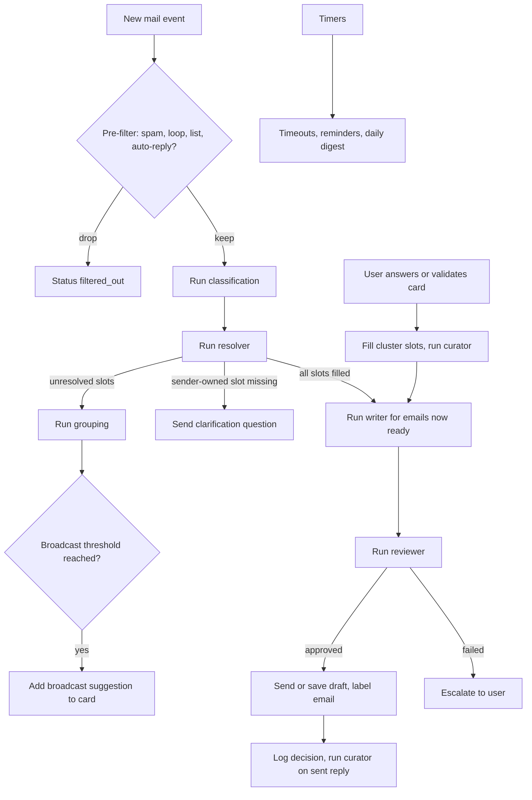

### 16.3 Classifier agent workflow

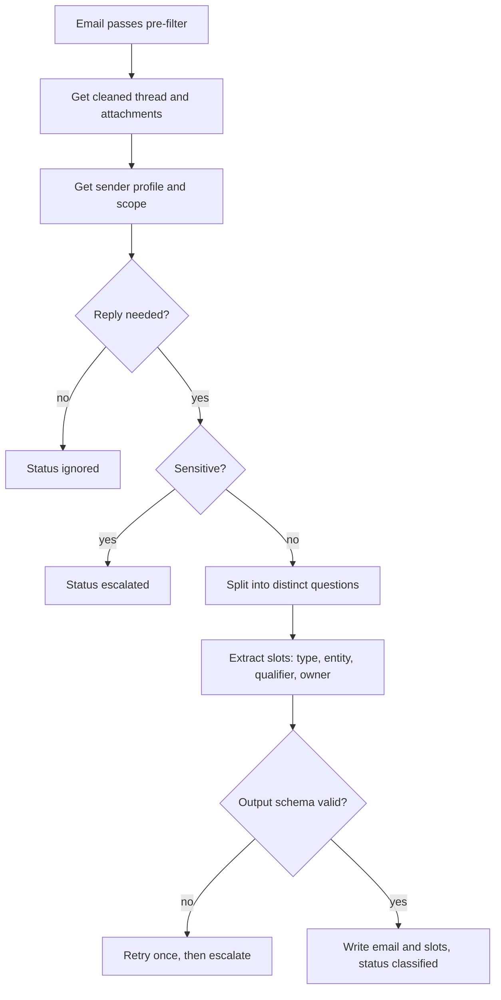

### 16.4 Resolver agent workflow

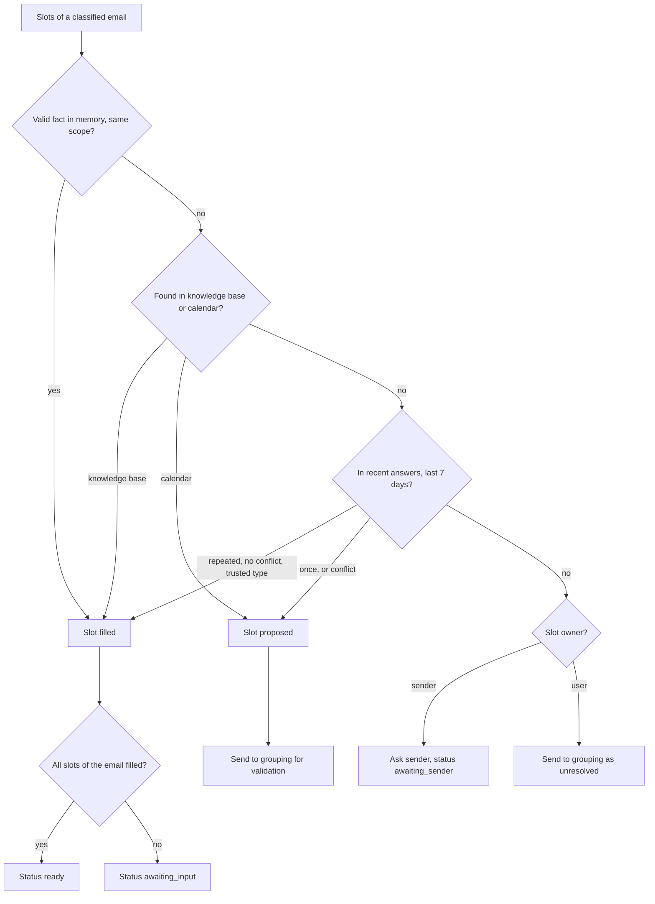

### 16.5 Grouping agent workflow

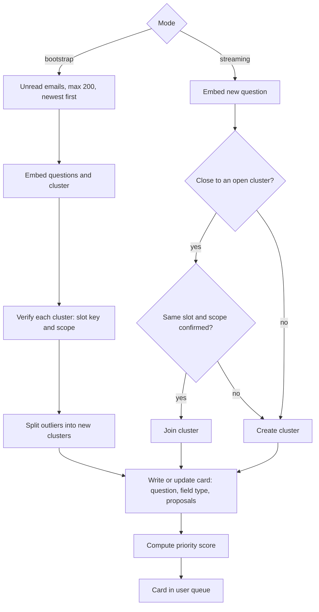

### 16.6 Writer agent workflow

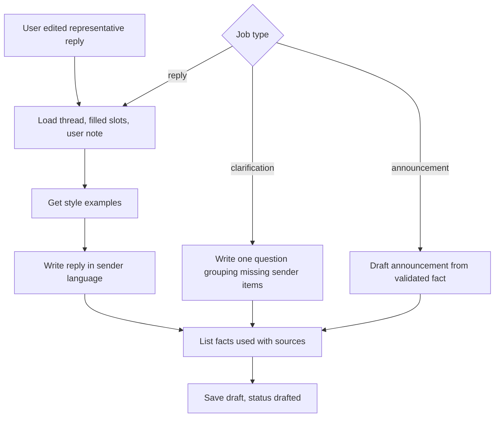

### 16.7 Reviewer agent workflow

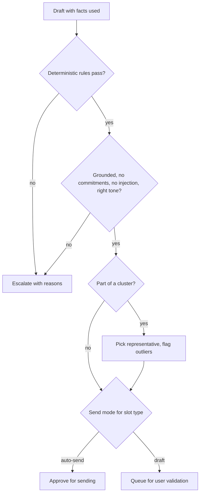

### 16.8 Curator agent workflow

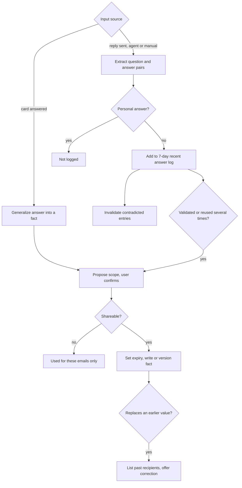
