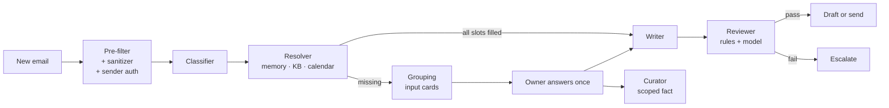

# Email Response Agent

A multi-agent system that answers a busy professor's email. It asks the owner only for what it cannot find, and asks for each piece of information **once**.

The core idea is the **input slot**: every fact a reply needs is extracted as a typed slot. Emails waiting on the same slot are grouped into one **input card**. The owner answers the card once, and every linked email gets its own reply in the sender's language. Answers become scoped, expiring facts that later emails reuse.

Everything runs on the owner's machine: local models through Ollama, PostgreSQL, and a review panel bound to `127.0.0.1`. No student email leaves the computer.

> Full design: [`Email Response Agent — System Design.md`](Email%20Response%20Agent%20—%20System%20Design.md) ·
> Design and security report (PDF): [`docs/report/email-response-agent-report.pdf`](docs/report/email-response-agent-report.pdf)

## How it works



A deterministic **orchestrator** (plain code, not an LLM) moves each email through a fixed lifecycle. Every transition is checked by a database trigger and recorded in an append-only decision log. Agents never call each other; they read and write a shared state.

| Agent | Job | Model |
| --- | --- | --- |
| Classifier | Intent, sensitivity, language, questions → typed slots | fast |
| Resolver | Fills slots from facts, knowledge base, calendar, recent replies | none (code) |
| Grouping | Clusters unresolved slots into input cards (embeddings + verification) | fast |
| Writer | One reply per email, listing every fact it used | strong |
| Reviewer | Deterministic rules first, then a model check | strong |
| Curator | Turns answers into scoped, expiring facts; learns from sent replies | fast |

## Security model

The full threat model is in sections 9, 13 and 15 of the design document. In short:

- **No LLM can send mail.** Only the orchestrator writes to the outbox, and only after a passed review of the current, unchanged draft. The database enforces this too.
- **Untrusted input stays data:**
  - The sanitizer strips hidden HTML, invisible Unicode and text-direction tricks.
  - The prompt-injection detector is rule-based and runs before any model sees the email. A model can only add to its score, never lower it.
- **Deterministic reply rules:**
  - The reply may only state numbers, links and commitments that come from a fact.
  - It must not touch a sensitive topic or contain an individual grade.
  - It must be in the right language, and must not itself read like instructions to a machine.
  - No model verdict can overrule a failed rule.
- **Sender authentication.** A `From:` address earns trust only when the receiving server's `Authentication-Results` shows DMARC pass, or DKIM aligned with the sender's domain. Unauthenticated senders are still shown to the owner, but get no scope, no memory reuse and no automatic reply.
- **Send policy:** drafts everywhere at launch, plus per-sender and daily rate limits. Personal slot types are never sent automatically, whatever the configuration says.
- **Local by default.** A non-local model address stops the start-up unless allowed explicitly.
- **Owner panel:**
  - Bound to `127.0.0.1`. Form login with a PBKDF2 hash and lockout after repeated failures.
  - CSRF tokens on every form; a strict CSP with no script at all; escaped templates.
- **Gmail mode is drafts-only.** It has no send call in the code, and it reads only allow-listed senders. The OAuth refresh token and client secret are readable by the owner's account only.
- **GDPR:**
  - Email addresses are redacted from logs. Prompts and answers are never logged.
  - Finished emails are erased after a retention period (365 days by default).

## Requirements

- Java 21
- Docker: dev and test start PostgreSQL automatically through Quarkus Dev Services
- [Ollama](https://ollama.com) with the models:
  ```shell
  ollama pull qwen2.5:7b
  ollama pull nomic-embed-text
  ```
  On a low-RAM machine, use `qwen2.5:3b` and set `FAST_MODEL=qwen2.5:3b`.

## Quick start (demo mailbox)

1. Copy the configuration: `cp .env.example .env`
2. Create the panel password hash, and put it in `.env` as `OWNER_PASSWORD_HASH`:
   ```shell
   java src/main/java/com/emailagent/web/PasswordHash.java 'your-password'
   ```
3. Start in dev mode:
   ```shell
   ./mvnw quarkus:dev
   ```
4. Open <http://localhost:8080/login> and sign in as `owner`. The demo inbox (`src/main/resources/mailbox/inbox.json`) is imported every 30 seconds.

| Page | What it shows |
| --- | --- |
| `/panel` | Input cards to answer, drafts to approve (grouped per card), escalations, broadcast suggestions |
| `/panel/memory` | What the agent knows: facts, with scope and expiry; forget any of them |
| `/panel/activity` | The audit trail of every step |
| `/panel/metrics` | Status counts, memory reuse, reviewer pass rate, rule failures |

## Gmail mode

Gmail mode reads the owner's Gmail and writes **drafts only**; the owner sends from Gmail.

1. In Google Cloud, create an OAuth client of type **Desktop app**. Save its JSON as `~/.emailagent/gmail-client.json`.
2. In `.env`, set:
   - `MAILBOX=gmail`
   - `GMAIL_ALLOWED_SENDERS`: a comma-separated list. Nothing else is ever read; empty means nothing is read.
   - `SEND_MODE=draft`. Gmail mode refuses anything else.
3. Start `./mvnw quarkus:dev`. On the first fetch a browser opens on Google's login page. The app uses PKCE, and the answer comes back on `127.0.0.1` only.

Sender authentication is always on in Gmail mode. If the university's mail is not DKIM-signed, every student appears as "sender not authenticated". Ask IT to enable DKIM/DMARC for the domain.

## Configuration

All settings live in `.env` (see [`.env.example`](.env.example)). `EnvExampleTest` keeps that file in sync with `application.properties`.

| Variable | Default | Purpose |
| --- | --- | --- |
| `SEND_MODE` | `draft` | `draft` or `auto`; auto applies only to slot types listed in `emailagent.auto-send-types` |
| `OWNER_ADDRESS` | `prof.martin@univ.example` | The mailbox owner; mail from it is never processed |
| `OWNER_PASSWORD_HASH` | empty | Panel login; empty means every login is refused |
| `OLLAMA_HOST` | `http://127.0.0.1:11434` | Must be local unless `emailagent.allow-remote-llm=true` |
| `FAST_MODEL` / `STRONG_MODEL` / `EMBED_MODEL` | `qwen2.5:7b` / `qwen2.5:7b` / `nomic-embed-text` | Model tiers |
| `MAILBOX` | `mock` | `mock` (fixtures) or `gmail`; chosen at build or dev start |
| `GMAIL_ALLOWED_SENDERS` | empty | The only senders Gmail mode reads |
| `RETENTION_DAYS` | `365` | Finished emails are erased after this |
| `DB_URL` / `DB_USER` / `DB_PASSWORD` | – | Production database (dev and test use Dev Services) |

Policy settings (auto-send types, rate limits, card priority weights, timeouts) are typed and documented in `src/main/java/com/emailagent/config/AppConfig.java`. An invalid value stops the start-up.

## Testing

```shell
./mvnw verify                                             # full suite (Docker required), no model needed
./mvnw test "-Dgroups=ollama" "-DexcludedGroups=none"     # agent tests against the local models
```

- Most tests use scripted models (`FakeLlmClient`, `FakeEmbedder`) through the real output parser.
- The evaluation set (`src/test/resources/eval/emails.json`, 35 labelled emails) measures classification and review against the targets in design doc §12. It runs with the local models (`EvaluationOllamaTest`).
- The attack corpus (`src/test/resources/attacks/corpus.json`, 19 attacks) runs end to end on every build: prompt injection, hidden text, exfiltration and impersonation.
- CI runs `./mvnw verify` and a gitleaks secret scan on every pull request.

## Project layout

```
src/main/java/com/emailagent/
├── web/           owner panel: login, queries, metrics, readable reasons
├── orchestrator/  lifecycle, outbox relay, send policy, follow-ups, broadcasts, retention
├── agents/        the six agents, review rules, classification routing, card priority
├── step/          the contract between orchestrator and agents: AgentStep, EmailSnapshot, StepResult
├── mailbox/       Mailbox interface, mock and Gmail mailboxes, importer, sender directory, owner-only secret files
├── llm/           LLM and embedding clients (Ollama), strict output parser, model tiers
├── security/      pre-filter, sanitizer, injection detector, sender authentication
├── store/         JPA entities, knowledge memory, knowledge base, calendar
├── config/        typed configuration, start-up checks, PII log filter
└── model/         enums and value types: statuses, slot types, scopes, IncomingEmail
src/main/resources/db/migration/   Flyway migrations, including the lifecycle and outbox guards
```

Packages are layered from top to bottom: a package may depend on those listed below it, never on those above. `ArchitectureTest` fails the build if a dependency cycle between packages appears.

## Packaging

```shell
./mvnw package                     # target/quarkus-app/quarkus-run.jar
./mvnw package -Dnative            # native executable (GraalVM)
```

`MAILBOX` is a build-time choice: build with `MAILBOX=gmail` for a Gmail deployment.
