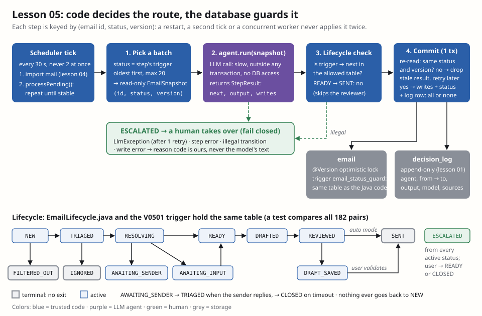

# Lesson 05 — Orchestrator: state machine, idempotence, audit log

**Owner:** Dhia (solo project; Claude built and verified the code, this file explains it).

## 🗺️ In plain words
The agents (lessons 06–12) are specialists that never talk to each other. Someone has to decide **who works next**,
and that someone is **plain code**, not a model: the orchestrator. It looks at each email's status, runs the one agent
that status calls for, checks that the agent's proposed next status is allowed, and saves the result together with an
audit row. Three properties matter:
1. **The route is fixed.** A status table says what may follow what. Nothing reaches `SENT` without passing `REVIEWED`.
2. **Every step happens once.** Restarts, a second tick or two workers can't apply the same step twice.
3. **Anything strange goes to a human.** Model failure, a crash in an agent, an illegal jump → `ESCALATED`.

**What you'll see:** a test agent that "obeyed the attacker" and asks to move an email from `READY` straight to `SENT`.
The orchestrator refuses, the email becomes `ESCALATED`, and the decision log says
`{"escalated":"illegal_transition"}`. Even raw SQL (`UPDATE email SET status='SENT'`) is refused by the database.



## 🧰 Tools
- **`quarkus-scheduler` (`@Scheduled`)**: a built-in cron. It runs the orchestrator every 30 s; `concurrentExecution =
  SKIP` means a slow tick is never overlapped by the next one.
- **JPA `@Version` (optimistic locking)**: a counter on each row; an `UPDATE … WHERE version = ?` that finds a different
  version fails. Like editing a shared document that refuses to save if someone saved since you opened it.
- **PostgreSQL trigger (PL/pgSQL)**: code inside the database that runs before every status change and can refuse it.
  The same idea as lesson 01's append-only log, applied to the lifecycle.
- **`QuarkusTransaction.requiringNew()`**: a short, explicit transaction. Used so that **no transaction stays open
  while the model thinks** (a 7B model can take 30 s).

## 🧠 How it works
**The lifecycle** (`orchestrator/EmailLifecycle.java`) is design doc §6 as an `EnumMap<EmailStatus, Set<EmailStatus>>`.
Two additions to the doc's diagram, both on purpose:
- every active status may go to `ESCALATED` (fail closed: whatever breaks, a human takes over);
- `ESCALATED → CLOSED` (the professor answered by hand or dismissed it).
`FILTERED_OUT`, `IGNORED`, `SENT`, `CLOSED` are terminal. No status leads back to `NEW`.

**The database holds the same table** (`V0501__orchestrator.sql`, trigger `email_status_guard`):
```sql
IF (OLD.status, NEW.status) IN (('NEW','TRIAGED'), …, ('REVIEWED','SENT'), …) THEN RETURN NEW; END IF;
RAISE EXCEPTION 'illegal status transition % -> %', OLD.status, NEW.status;
```
Two copies of a rule can drift apart, so `LifecycleDatabaseGuardTest` tries **all 182 pairs** against the real
database and fails if the trigger and the Java table disagree on even one.

**An agent, as the orchestrator sees it** (`orchestrator/AgentStep.java`): a `name`, the one `trigger` status it
handles, and `run(EmailSnapshot)` which returns a `StepResult(next, output, confidence, sources, modelVersion, writes)`.
- `EmailSnapshot` is a read-only record: the agent can't save it or set a status.
- `run` does the slow part (LLM calls) and **touches no database**. Its writes (intent, slots…) travel back as a
  `writes` callback the orchestrator applies later.
- At start-up, `Orchestrator.routingTable` refuses two agents on one status (ambiguous route) or an agent on a terminal
  status (e.g. a "re-send" step on `SENT`). The application doesn't start: fail closed at wiring time.

**One step** (`orchestrator/Orchestrator.java`, `runStep`):
1. **Pick a batch**: emails in the trigger status, oldest first, at most `orchestrator-batch-size` (20), copied to
   snapshots in a short transaction.
2. **Run the agent** outside any transaction.
   - `LlmException` (the client already retried once, lesson 02) → escalate with `llm_invalid_output` / `llm_timeout`…
   - any other exception → escalate with `step_error` (the log gets the exception *type*, never content).
3. **Check the transition**: `EmailLifecycle.allowed(snapshot.status, result.next)`; if not → escalate
   `illegal_transition`.
4. **Commit** in one new transaction: re-read the email; if its **status or version** changed since the snapshot, the
   result is **stale** → drop it (the next tick recomputes on fresh data). Otherwise apply `writes`, *then* set the status
   (so a write can't pick the status), then insert a `decision_log` row with `from_status`/`to_status`. The three commit
   together or not at all; a failing write rolls everything back and the email escalates with `write_error`.

`processPending()` repeats rounds over all steps until nothing moves (max 10 rounds), so one tick can carry an email
through several steps, but a bug can't spin forever. `OrchestratorJob` is the heartbeat: import mail (lesson 04), then
`processPending()`. With no agents registered yet, a dev-mode tick logs `tick: 8 imported, 4 filtered, 0 transitions`.

**Idempotence, precisely.** The design doc says "every step is keyed by email id and status". We key on
**(id, status, version)**: status alone isn't enough, because an email can be *edited* without changing status (a
sender's follow-up merged into the thread, a user's correction), and a draft computed on the old text must not be saved.
Two layers enforce it:
- the explicit `stillAt(current, snapshot)` check at commit;
- `@Version`: if another transaction commits between our check and our commit, Hibernate's
  `UPDATE … WHERE version = ?` matches no row, the commit fails, and we treat it as "someone else won".

**What about sending?** Every step so far is *side-effect free until commit*: re-running it costs compute, never a
duplicate. Sending is different (an email can't be "rolled back"). Lesson 11 adds a deterministic reply `Message-ID`
so that even a retried send is recognised as a duplicate: at-least-once delivery + idempotent effect = effectively once.

## ⚖️ Design choices and trade-offs
| Choice | Rejected alternative | Why |
|---|---|---|
| Orchestrator in plain code | An LLM "manager agent" that picks the next agent | Routing must be predictable, testable and impossible to inject. A manager LLM reading the email could be told "skip review" |
| Agents never call each other, only through state | Agents chaining calls directly | No hidden paths: every hop is a status change in the DB, logged and checked against the table |
| State machine in Java **and** a DB trigger | Java only | Defense in depth: later code (web panel, a bug, raw SQL) can't skip the reviewer either. A test keeps both copies equal |
| LLM call outside the transaction, commit after | One transaction around the whole step | Holding a DB transaction + row lock for 30 s of model time blocks other work and times out connections |
| Optimistic lock (`version`) | Pessimistic `SELECT … FOR UPDATE`, or a lease column | One worker today; optimistic costs nothing when there's no conflict. A lease (`locked_until`) would avoid duplicate *LLM work* across several instances: noted for scaling, not needed now |
| Key = (id, status, version) | (id, status) as in the doc | Status alone would save a draft computed on an email that was edited meanwhile |
| Agent proposes `next`, code validates | Agent sets the status itself | The agent is code, but the model influences its output; the lifecycle check is where code has the last word |
| Escalate on any failure | Retry the step forever, or skip it silently | A poison email would loop forever; skipping hides it. A human queue is visible and bounded |
| Reason codes we choose (`llm_timeout`) | Logging the exception message or model output | The model's text can be the attacker's text or personal data (OWASP LLM02) |
| Polling tick every 30 s | Event-driven queue (Kafka, LangGraph) | Mail arrives in minutes, not milliseconds. Polling the DB is simple and survives restarts; the design doc §14 mentions frameworks "once flows grow" |

**Decision:** every active status may escalate, and `ESCALATED → CLOSED` is allowed, because the doc's diagram only
shows escalation from `triaged` and `drafted`, but its retry rule ("a second failure escalates") applies to every agent.

## 🔐 Security
- **LLM06 Excessive agency** → agents can't change a status or call each other; they return a proposal, and code
  holding the lifecycle table decides. The model's maximum influence is "pick one of the allowed next statuses".
- **LLM01 Prompt injection (worst case: obedient model)** → even if the triage model is fully hijacked, it can't jump to
  `SENT`: Java refuses, and the DB refuses again.
- **Tampering (STRIDE)** → `email_status_guard` trigger: no SQL path skips a state. The decision log is append-only
  (lesson 01) and now records `from → to` for every transition.
- **Repudiation (STRIDE)** → every transition has an audit row: which agent, which statuses, what it reported, when.
- **Denial of service / LLM10** → bounded batch (20), bounded rounds (10), one tick at a time, a failing email escalates
  instead of retrying forever, one email's DB failure doesn't stop the others.
- **Information disclosure** → logs and escalation reasons contain ids and exception types only.

### 🧨 Attack it
- `OrchestratorTest.anObedientAgentCannotSkipTheReviewer`: agent proposes `READY → SENT` → `ESCALATED`,
  log `illegal_transition`.
- `LifecycleDatabaseGuardTest.databaseAllowsExactlyTheLifecycleTransitions`: 182 raw `UPDATE`s; the DB accepts exactly
  the Java table (e.g. `NEW → SENT`: `illegal status transition NEW -> SENT`).
- `aResultComputedOnOldDataIsDiscardedAndRecomputed`: the email is edited while the "model thinks" → the result is
  dropped, nothing logged; the next run recomputes and commits.
- `eachStepRunsOnceAndEveryTransitionIsLogged`: two runs, each agent called exactly once, log
  `writer:READY->DRAFTED`, `reviewer:DRAFTED->REVIEWED`.
- `writesAndStatusChangeCommitTogetherOrNotAtAll`: a write fails halfway → the half-written `intent` is rolled back
  with the transition; email escalated with `write_error`.
- `aWriteCannotChooseTheStatus`, `aModelFailureEscalates`, and `EmailLifecycleTest` (nothing reaches `SENT` without the
  reviewer, every active status can escalate, nothing returns to `NEW`, ambiguous wiring stops the app).

## 🎓 Questions the professor may ask
- **Why isn't the orchestrator an LLM, like in many "multi-agent" frameworks?** Routing is a policy decision with
  security impact (skipping the reviewer = sending unchecked mail). Code is deterministic, testable, free and can't be
  prompt-injected. The LLMs do language work; code does control flow.
- **Then is it really a multi-agent system?** Yes: autonomous specialists with their own goals, prompts and models,
  coordinating through a shared environment (the "blackboard" pattern) instead of direct messages. The orchestrator is
  the control component of the blackboard, not an agent that reasons.
- **What does idempotence mean here and how do you guarantee it?** Running the orchestrator twice (or after a crash)
  gives the same result as once. A step commits only if the email is still at the (status, version) the agent saw;
  `@Version` covers the race in the last milliseconds. Agents write nothing before commit, so re-running costs compute,
  never duplicates.
- **Why keep the transition table in the database too?** Defense in depth: the web panel (lesson 13), a future bug or
  an SQL injection can't skip states. A test compares both tables on all 182 pairs so they can't drift.
- **Why not open the transaction for the whole step?** A local 7B model can take tens of seconds; a long transaction
  holds locks and connections. So: read snapshot → think without a transaction → short commit with a version check.
- **What happens if the model returns garbage twice?** `LlmClient` retries once; the second
  failure throws `LlmException`; the orchestrator escalates the email with a reason code. Fail closed.
- **What if the JVM crashes in the middle of a step?** Nothing was committed (agents write only at commit), the email is
  still in its status, the next tick re-runs the step. For sending, lesson 11 adds a deterministic `Message-ID` so a
  retried send is a duplicate the mailbox recognises.
- **How would you scale to several instances?** Add a lease (`locked_by`, `locked_until`) claimed with a conditional
  `UPDATE` to avoid two instances paying for the same LLM call; correctness is already guaranteed by the version check.

## ✅ Proof
`.\mvnw verify`: 45 tests, BUILD SUCCESS (adds `EmailLifecycleTest` 5, `LifecycleDatabaseGuardTest` 1,
`OrchestratorTest` 6). Flyway now at `V0501`. Dev mode: the scheduled tick imports the demo inbox
(`8 imported, 4 filtered, 0 transitions`; agents arrive from lesson 06).

## Your next action
1. Read the 🎓 questions and the trade-off table; be ready to draw the lifecycle on the board.
2. Read `Orchestrator.runOne` and `commit` (about 60 lines): that's the whole idempotence argument.
