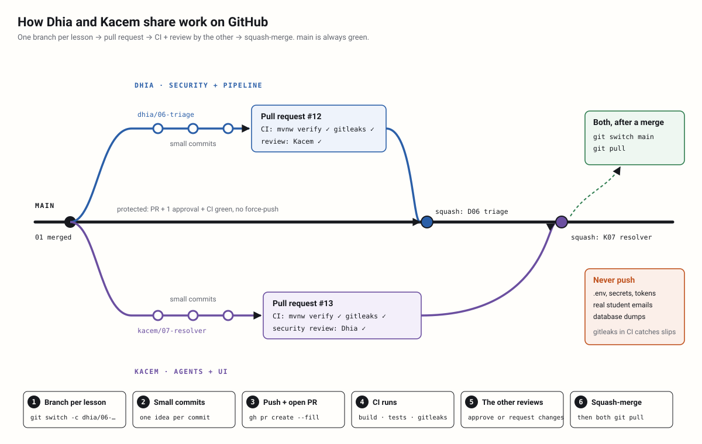

# Lesson 00b — Working as a team on GitHub

**Owner:** Both (Dhia: CI + CODEOWNERS · Kacem: PR template + Dependabot; each reviews the other's PR)

## 🗺️ In plain words: what we're doing today
You are two people writing one program. Without rules, you overwrite each other's work, push a broken `main`, or
leak a secret. Today you set up the team workflow: every lesson is done on its own **branch**, sent as a **pull
request**, checked automatically by GitHub (**CI**: build, tests, secret scan), and **reviewed by the other person**
before it is merged. You also each open your first real PR, so you practice the whole loop once.
**What you'll see when it works:** a PR page on GitHub with a green ✓ next to "ci / build" and "Approved by Kacem"
(or by Dhia), then a merge button.

## 🎯 Goal
A repo where `main` is always green, every change is reviewed by the other person, and CI blocks broken code and leaked
secrets. This is also a security control: a second pair of eyes on every PR, as at real companies.

## 🧰 Tools in this step
- **Git branches + pull requests**: a branch is your private draft; a PR is "please read this before it goes into the
  shared version". Every lesson from now on ends with the branch and PR commands.
- **GitHub Actions (CI)**: a robot that runs on every PR, builds the project and runs the tests on a clean Linux machine.
  It catches "works on my machine" and blocks a red PR. [Docs](https://docs.github.com/actions)
- **gitleaks**: a secret scanner. It reads every commit looking for tokens, passwords and keys, because a secret
  pushed to GitHub has to be treated as leaked, even if you delete it later. [Docs](https://github.com/gitleaks/gitleaks)
- **CODEOWNERS**: a file that says who owns which folder; GitHub asks that person to review automatically.
  [Docs](https://docs.github.com/repositories/managing-your-repositorys-settings-and-features/customizing-your-repository/about-code-owners)
- **Dependabot**: a robot that opens PRs when a dependency (Maven or a GitHub Action) has a new version or a known
  vulnerability. This is supply-chain security (OWASP LLM03). [Docs](https://docs.github.com/code-security/dependabot)
- **`gh` (GitHub CLI)**: GitHub from PowerShell: open PRs, review, merge. [Docs](https://cli.github.com/manual/)



## 💻 Commands

### 1. Kacem: accept the invitation and clone
Dhia already created the private repo `dhiasalah/email-response-agent` and invited `KacemAbdelbaki`. Accept it from the
email or at https://github.com/notifications, then:
```powershell
winget install GitHub.cli
gh auth login
cd "$HOME\Desktop"
git clone https://github.com/dhiasalah/email-response-agent.git
cd email-response-agent
```
Expected output (last lines):
```
✓ Logged in as KacemAbdelbaki
Cloning into 'email-response-agent'...
```

### 2. Both: identity and pull habits
```powershell
git config user.name                # Dhia: dhiasalah · Kacem: KacemAbdelbaki
git config user.email
git config --global pull.rebase true
git config --global fetch.prune true
```
`user.name` matters: each of you runs Claude Code in this repo, and `CLAUDE.md` uses it to know whose lessons and
progress to follow. `pull.rebase` keeps your branch history linear when you update it from `main`.

### 3. The loop used for every lesson
**Claude runs this loop for you** after each verified lesson (see "Git workflow" in `CLAUDE.md`): it checks for secrets,
commits, pushes, opens the PR with the other student as reviewer, and switches to the next lesson's branch. Merging stays
human. You should still know the commands, to read what Claude did and to fix things by hand:
```powershell
git switch main; git pull
git switch -c dhia/03-injection-101        # or kacem/02-llm-client
# ... code, test ...
git add -A; git commit -m "Lesson 03: untrusted-data envelope"
git push -u origin HEAD
gh pr create --fill --reviewer KacemAbdelbaki   # Kacem uses --reviewer dhiasalah
```
After approval and green CI: `gh pr merge --squash --delete-branch`, then both `git switch main; git pull`.
Before `git add -A`, always run `git status` and read the list: that's your last chance to see a `.env` or a real email.

## 🧩 Code, piece by piece

### 1. Dhia: CI workflow
**Where:** `.github/workflows/ci.yml` — new file, on branch `dhia/00b-ci`.

```yaml
name: ci

on:
  pull_request:
  push:
    branches: [main]

permissions:
  contents: read

concurrency:
  group: ci-${{ github.ref }}
  cancel-in-progress: true

jobs:
  build:
    runs-on: ubuntu-latest
    timeout-minutes: 20
    steps:
      - uses: actions/checkout@v4
        with:
          fetch-depth: 0          # gitleaks scans the whole history of the PR
          persist-credentials: false

      - uses: actions/setup-java@v4
        with:
          distribution: temurin
          java-version: "21"
          cache: maven

      - name: Build and test (no Ollama in CI; Dev Services starts Postgres in Docker)
        run: ./mvnw -B verify

      - name: Secret scan
        uses: gitleaks/gitleaks-action@v2
        env:
          GITHUB_TOKEN: ${{ secrets.GITHUB_TOKEN }}
```
The job is called `build`; that name becomes the required check in step 4. `permissions: contents: read` gives the
workflow's token the least access possible, so even a malicious dependency running in CI can't push to your repo.
`persist-credentials: false` stops that token from being left in `.git/config` for later steps. Tests tagged
`ollama` are excluded by the `pom.xml` property from lesson 00, so CI never needs a model; this is why lesson 01
gives you a `FakeLlmClient`. GitHub's runners have Docker, so Dev Services Postgres works there too.
Supply-chain note: `actions/*` are GitHub's own; `gitleaks-action` is third-party, so Dependabot (Kacem's piece) keeps
it updated, and pinning it to a full commit SHA is even stricter.

### 2. Dhia: who owns what
**Where:** `.github/CODEOWNERS` — new file, same branch.

```text
# Default: both of you see everything
*                                         @dhiasalah @KacemAbdelbaki

# Dhia's track: security + pipeline
/src/main/java/com/emailagent/security/      @dhiasalah
/src/main/java/com/emailagent/mailbox/       @dhiasalah
/src/main/java/com/emailagent/orchestrator/  @dhiasalah

# Kacem's track: agents + UI
/src/main/java/com/emailagent/llm/           @KacemAbdelbaki
/src/main/java/com/emailagent/web/           @KacemAbdelbaki
/src/main/resources/templates/               @KacemAbdelbaki

# Changing the rules themselves needs Dhia (security owner)
/.github/                                    @dhiasalah
```
GitHub reads this file and automatically requests a review from the owner of each touched folder. The last rule
matters most: whoever can edit CI or CODEOWNERS can switch off every other check, so changes there always go to
the security owner.

Then:
```powershell
git add .github; git commit -m "Lesson 00b: CI (build, tests, gitleaks) + CODEOWNERS"
git push -u origin HEAD; gh pr create --fill --reviewer KacemAbdelbaki
```

### 3. Kacem: PR template
**Where:** `.github/pull_request_template.md` — new file, on branch `kacem/00b-pr-template`.

```markdown
## Lesson
<!-- e.g. Lesson 07 — Resolver (lessons/kacem/07-resolver.md) -->

## What changed
-

## How I tested it
- [ ] `./mvnw verify` is green locally
- [ ] Ollama tests run if this touches an agent: `./mvnw test "-Dgroups=ollama" "-DexcludedGroups=none"`

## Security checklist
- [ ] No secrets, tokens or `.env` in the diff
- [ ] No real student emails or personal data (fixtures are fake)
- [ ] Email content and LLM output are treated as untrusted (validated, never executed, never rendered as raw HTML)
- [ ] No new capability for an LLM agent (no send / forward / write tools)
- [ ] New dependencies are explained below

## Notes for the reviewer
```
Every PR now opens with this text. The security checklist turns the course's rules into five questions both of you
answer every time. When you review, check the ticked boxes against the diff rather than taking them on trust.

### 4. Kacem: Dependabot
**Where:** `.github/dependabot.yml` — new file, same branch.

```yaml
version: 2
updates:
  - package-ecosystem: maven
    directory: "/"
    schedule:
      interval: weekly
    open-pull-requests-limit: 5
  - package-ecosystem: github-actions
    directory: "/"
    schedule:
      interval: weekly
```
Dependabot opens a PR each week when a Maven dependency or a GitHub Action has an update, and CI runs on it like on
your own PRs. Because this file lives in `.github/`, CODEOWNERS sends it to Dhia: your first security review.

Then:
```powershell
git add .github; git commit -m "Lesson 00b: PR template + Dependabot"
git push -u origin HEAD; gh pr create --fill --reviewer dhiasalah
```

### 5. Dhia: protect `main` (needs GitHub Pro: free with the Student Developer Pack)
On **GitHub Free**, rulesets and branch protection don't apply to **private** repos owned by a personal account.
Get GitHub Pro for free with the [Student Developer Pack](https://education.github.com/pack) (university email),
then create the ruleset.

**Where:** `ruleset.json` — a temporary file outside git (delete it after).

```json
{
  "name": "protect-main",
  "target": "branch",
  "enforcement": "active",
  "conditions": { "ref_name": { "include": ["~DEFAULT_BRANCH"], "exclude": [] } },
  "rules": [
    { "type": "deletion" },
    { "type": "non_fast_forward" },
    { "type": "pull_request", "parameters": {
        "required_approving_review_count": 1,
        "dismiss_stale_reviews_on_push": true,
        "require_code_owner_review": false,
        "require_last_push_approval": true,
        "required_review_thread_resolution": true } },
    { "type": "required_status_checks", "parameters": {
        "strict_required_status_checks_policy": true,
        "required_status_checks": [ { "context": "build" } ] } }
  ]
}
```
```powershell
gh api -X POST repos/dhiasalah/email-response-agent/rulesets --input ruleset.json
Remove-Item ruleset.json
```
This blocks direct pushes, force-pushes and deleting `main`, and requires one approval plus a green `build`
check. `dismiss_stale_reviews_on_push` + `require_last_push_approval` close a classic trick: you can't get an
approval and then push new code under it. No bypass list, so the rules apply to Dhia too, even though Dhia is the repo
owner. Without Pro, apply the same rules by habit: never push to `main`, and never merge a red or unreviewed PR.

## 📚 Key concepts
- **Separation of duties**: the author never approves their own change. It's the human version of "the LLM proposes,
  code decides".
- **Shift left**: catch problems (broken build, leaked secret, vulnerable dependency) on the PR, before they reach `main`.
- **Least privilege in CI**: `permissions: contents: read`, no stored credentials, and changes to `.github/` owned by the security owner.
- **Squash-merge**: one lesson = one commit on `main`, so `main` reads like your course and is easy to revert.

## 🔐 Security note
- A secret that reaches GitHub is **burned**: rotate it, don't just delete the commit. gitleaks is the safety net, and `git status` before every commit is the first line.
- Never commit real emails, even "just to test": the repo has two readers, CI logs, and possibly a public future.
- Secret scanning + push protection from GitHub itself are free on **public** repos only; for this private repo gitleaks does that job.

## ✅ Check it works
```powershell
gh pr checks
gh pr view --json reviewDecision,mergeStateStatus
```
Expected output (after CI and the other person's approval):
```
build   pass   ...
{"mergeStateStatus":"CLEAN","reviewDecision":"APPROVED"}
```
Then merge: `gh pr merge --squash --delete-branch`. If you made the ruleset, also try `git push origin main` from a local
commit on `main`: it should be **rejected**.

## 🌿 Branch & PR
- Dhia: `dhia/00b-ci` → reviewer Kacem.
- Kacem: `kacem/00b-pr-template` → reviewer Dhia (security review of `.github/` changes).

## ➡️ Next step
Lesson 01 (shared, pair session): the data model and the contracts both tracks code against (`LlmClient` + `FakeLlmClient`).
Then the tracks split: Kacem starts lesson 02, and Dhia starts lesson 03. Tell Claude "go next".

## Your next action
1. Kacem: accept the invitation, install `gh`, clone, set `user.name`/`user.email`.
2. Each of you: open your 00b PR, review the other's, merge both.
3. Dhia: claim the Student Developer Pack, then add the `protect-main` ruleset.
