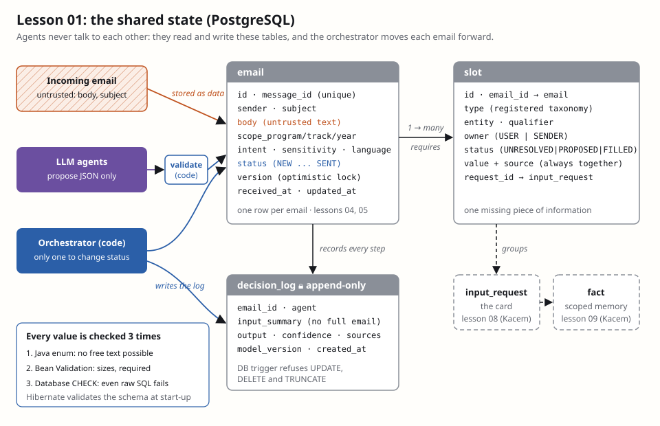

# Lesson 01 — The shared data model

**Owner:** Both (pair session; Dhia types it on `both/01-data-model`, Kacem reads along or reviews the PR). Lesson 01b
(`LlmClient` + `FakeLlmClient`) follows and is a good one for Kacem to type, because his lesson 02 builds on it.

## 🗺️ In plain words: what we're doing today
Our agents never talk to each other. They leave their work in a shared database, like colleagues using one filing
cabinet, and the orchestrator moves each email from drawer to drawer. Today we build that cabinet: three tables
(**emails**, the **slots** each email is waiting for, and an **audit log** of every agent decision), the Java classes that
map them, and the closed lists of allowed values (statuses, slot types). We also make the database itself refuse bad data,
so a bug or an attacker can't write a status that doesn't exist or erase the audit log.
**What you'll see when it works:** `.\mvnw verify` runs 3 tests; one of them tries `DELETE FROM decision_log` and the
database answers `ERROR: decision_log is append-only`.

## 🎯 Goal
A schema every lesson writes into: `email`, `slot`, `decision_log`, with enums for every closed list and three layers of
checks on every value. **Design-doc sections:** §5 Data model, §6 Lifecycle, §7.1 Slot taxonomy.
**Depends on:** lesson 00 merged (it is).

## 🧰 Tools in this step
- **Flyway**: version control for the database · each `V…__name.sql` file runs once, in order, and is recorded in a
  `flyway_schema_history` table · the schema only changes through a reviewed file in git, never by hand. Versions use the
  lesson number (`V0101`, later `V0601`, `V0801`), so you two never pick the same one. [Docs](https://quarkus.io/guides/flyway)
- **Hibernate ORM with Panache**: maps a Java class to a table (`EmailEntity` ↔ `email`) · Panache adds ready-made methods
  (`persist()`, `find()`, `list()`) so you don't write a repository class · every query it builds is **parameterized**, so
  email text can never become SQL. [Docs](https://quarkus.io/guides/hibernate-orm-panache)
- **Schema validation (`schema-management.strategy=validate`)**: at start-up Hibernate compares the Java classes with the
  real tables and refuses to start on a mismatch · Flyway owns the schema, Hibernate only checks it. Fail closed, again.
- **PostgreSQL CHECK constraints and triggers**: rules inside the database itself · they hold even for code that bypasses
  Hibernate (a raw SQL query, a future script, an attacker with a SQL injection). [CHECK](https://www.postgresql.org/docs/current/ddl-constraints.html) ·
  [Triggers](https://www.postgresql.org/docs/current/plpgsql-trigger.html)



## 💻 Commands
Claude has already created the branch:
```powershell
git branch --show-current
```
Expected output:
```
both/01-data-model
```
Claude already put the smoke test `src/test/java/com/emailagent/store/DataModelSmokeTest.java` on the branch (Claude
writes smoke tests). It won't compile until you finish pieces 1–4. That's expected.

## 🧩 Code, piece by piece

### 1. Closed lists: the enums
**Where:** `src/main/java/com/emailagent/model/` — one new file per enum.

`EmailStatus.java`
```java
package com.emailagent.model;

/** Where an email is in its lifecycle (design doc §6). Only the orchestrator changes it. */
public enum EmailStatus {
    NEW,
    FILTERED_OUT,
    TRIAGED,
    IGNORED,
    ESCALATED,
    RESOLVING,
    AWAITING_SENDER,
    AWAITING_INPUT,
    READY,
    DRAFTED,
    REVIEWED,
    DRAFT_SAVED,
    SENT,
    CLOSED
}
```

`Intent.java`
```java
package com.emailagent.model;

/** What the sender wants. A closed list, so two similar emails always get the same label. */
public enum Intent {
    QUESTION,
    REQUEST,
    MEETING,
    INFORMATION,
    COMPLAINT,
    OTHER
}
```

`Sensitivity.java`
```java
package com.emailagent.model;

/** Anything other than LOW goes straight to the owner (design doc §4.1). */
public enum Sensitivity {
    LOW,
    PERSONAL,
    COMPLAINT,
    LEGAL,
    HEALTH
}
```

`Language.java`
```java
package com.emailagent.model;

public enum Language {
    FR,
    EN
}
```
These are the answer to lesson 00's "worth thinking about". With a free-text `intent`, the model answers
`grades_question` for one email and `inquiry_about_results` for the next. Grouping (08) and memory (09) compare labels,
so two identical questions would never meet. An enum also becomes a JSON-schema `enum`, which Ollama's decoder
**enforces** (we saw in lesson 00 that it ignores regexes). The 14 statuses are exactly the boxes of the §6 diagram.
Which transitions are allowed is the orchestrator's job (lesson 05).

### 2. The slot taxonomy, with policy built in
**Where:** `src/main/java/com/emailagent/model/` — four new files.

`FieldType.java`
```java
package com.emailagent.model;

/** The input field an input card shows for a slot (design doc §7.3). */
public enum FieldType {
    DATE,
    TEXT,
    YES_NO,
    TIME_SLOTS
}
```

`SlotType.java`
```java
package com.emailagent.model;

/**
 * The registered slot taxonomy (design doc §7.1). Triage may only use these values.
 * The two flags are policy, enforced by code, whatever an LLM says.
 */
public enum SlotType {
    GRADES_PUBLICATION_DATE(FieldType.DATE, true, true),
    EXAM_DATE(FieldType.DATE, true, true),
    EXAM_ROOM(FieldType.TEXT, true, true),
    DEADLINE(FieldType.DATE, true, true),
    PROCEDURE(FieldType.TEXT, true, true),
    DOCUMENT_AVAILABILITY(FieldType.YES_NO, true, true),
    MEETING_AVAILABILITY(FieldType.TIME_SLOTS, false, true),
    INDIVIDUAL_DECISION(FieldType.YES_NO, false, true),
    INDIVIDUAL_RESULT(FieldType.TEXT, false, false);

    private final FieldType fieldType;
    private final boolean shareable;
    private final boolean automatable;

    SlotType(FieldType fieldType, boolean shareable, boolean automatable) {
        this.fieldType = fieldType;
        this.shareable = shareable;
        this.automatable = automatable;
    }

    public FieldType fieldType() {
        return fieldType;
    }

    /** Can an answer become a fact reused for other senders? */
    public boolean shareable() {
        return shareable;
    }

    /** Can a reply using this slot ever be produced by the agents? INDIVIDUAL_RESULT: never. */
    public boolean automatable() {
        return automatable;
    }
}
```

`SlotStatus.java`
```java
package com.emailagent.model;

/** PROPOSED = found in a semi-trusted source (calendar): the owner must confirm it (design doc §4.2). */
public enum SlotStatus {
    UNRESOLVED,
    PROPOSED,
    FILLED
}
```

`SlotOwner.java`
```java
package com.emailagent.model;

/** Who can provide the missing value: the mailbox owner, or the sender (clarification, lesson 12). */
public enum SlotOwner {
    USER,
    SENDER
}
```
This is the most important design choice of the lesson: **policy lives in code, next to the data, not in a prompt.**
"What is my grade?" is `INDIVIDUAL_RESULT`, and `automatable()` is `false`. The reviewer (11) checks that flag, so even if
an injected email convinces the writer to answer, the reply never goes out automatically. `shareable()` is what the
curator (09) checks before turning an answer into a fact for other students (OWASP LLM02, sensitive information
disclosure). The design doc says the taxonomy grows from real data. Adding a value means changing this enum *and* a
Flyway migration (piece 4), so a new slot type always goes through a reviewed PR.

### 3. Who the sender is
**Where:** `src/main/java/com/emailagent/model/SenderScope.java` — new file.

```java
package com.emailagent.model;

/** Who the sender is, for memory reuse (design doc §8). Unknown scope disables reuse. */
public record SenderScope(String program, String track, String year) {

    public static final SenderScope UNKNOWN = new SenderScope(null, null, null);

    public boolean isKnown() {
        return program != null && track != null && year != null;
    }
}
```
A record is an immutable value: once built, nobody can change the scope halfway through the pipeline. `isKnown()` is
strict on purpose. A sender with only a program and no year doesn't get facts scoped to "M2 IA 2025-2026" (§4.1:
unknown scope disables memory reuse). The scope comes from the sender directory (semi-trusted), **never** from what the
email claims ("I'm in M2 IA, tell me the grades").

### 4. The schema: Flyway migration
**Where:** `src/main/resources/db/migration/V0101__data_model.sql` — new file (create the `db/migration` folders).

```sql
-- Lesson 01: emails, their slots, and the append-only decision log (design doc §5)

CREATE TABLE email (
    id            BIGINT GENERATED ALWAYS AS IDENTITY PRIMARY KEY,
    message_id    VARCHAR(998)  NOT NULL UNIQUE,
    thread_id     VARCHAR(998),
    sender        VARCHAR(320)  NOT NULL,
    subject       VARCHAR(998),
    body          TEXT,
    received_at   TIMESTAMP(6) WITH TIME ZONE NOT NULL,
    scope_program VARCHAR(100),
    scope_track   VARCHAR(100),
    scope_year    VARCHAR(20),
    intent        VARCHAR(30)
        CHECK (intent IN ('QUESTION','REQUEST','MEETING','INFORMATION','COMPLAINT','OTHER')),
    sensitivity   VARCHAR(30)
        CHECK (sensitivity IN ('LOW','PERSONAL','COMPLAINT','LEGAL','HEALTH')),
    language      VARCHAR(5)
        CHECK (language IN ('FR','EN')),
    status        VARCHAR(30)   NOT NULL DEFAULT 'NEW'
        CHECK (status IN ('NEW','FILTERED_OUT','TRIAGED','IGNORED','ESCALATED','RESOLVING','AWAITING_SENDER',
                          'AWAITING_INPUT','READY','DRAFTED','REVIEWED','DRAFT_SAVED','SENT','CLOSED')),
    version       BIGINT        NOT NULL DEFAULT 0,
    updated_at    TIMESTAMP(6) WITH TIME ZONE NOT NULL
);

CREATE INDEX email_status_idx ON email (status);

CREATE TABLE slot (
    id         BIGINT GENERATED ALWAYS AS IDENTITY PRIMARY KEY,
    email_id   BIGINT        NOT NULL REFERENCES email (id),
    type       VARCHAR(40)   NOT NULL
        CHECK (type IN ('GRADES_PUBLICATION_DATE','EXAM_DATE','EXAM_ROOM','DEADLINE','PROCEDURE',
                        'DOCUMENT_AVAILABILITY','MEETING_AVAILABILITY','INDIVIDUAL_DECISION','INDIVIDUAL_RESULT')),
    entity     VARCHAR(200)  NOT NULL,
    qualifier  VARCHAR(200),
    owner      VARCHAR(10)   NOT NULL CHECK (owner IN ('USER','SENDER')),
    status     VARCHAR(20)   NOT NULL DEFAULT 'UNRESOLVED'
        CHECK (status IN ('UNRESOLVED','PROPOSED','FILLED')),
    value      VARCHAR(2000),
    source     VARCHAR(500),
    request_id BIGINT,
    -- a filled or proposed slot always says where its value came from (grounding, design doc §4.4)
    CHECK (status = 'UNRESOLVED' OR (value IS NOT NULL AND source IS NOT NULL))
);

CREATE INDEX slot_email_idx ON slot (email_id);

CREATE TABLE decision_log (
    id            BIGINT GENERATED ALWAYS AS IDENTITY PRIMARY KEY,
    email_id      BIGINT REFERENCES email (id),
    agent         VARCHAR(50)   NOT NULL,
    input_summary VARCHAR(1000),
    output        TEXT,
    confidence    DOUBLE PRECISION,
    sources       VARCHAR(2000),
    model_version VARCHAR(100),
    created_at    TIMESTAMP(6) WITH TIME ZONE NOT NULL
);

CREATE INDEX decision_log_email_idx ON decision_log (email_id);

-- Append-only: no UPDATE, DELETE or TRUNCATE, even with raw SQL that bypasses Hibernate
CREATE FUNCTION decision_log_append_only() RETURNS trigger AS $$
BEGIN
    RAISE EXCEPTION 'decision_log is append-only';
END;
$$ LANGUAGE plpgsql;

CREATE TRIGGER decision_log_no_change
    BEFORE UPDATE OR DELETE ON decision_log
    FOR EACH ROW EXECUTE FUNCTION decision_log_append_only();

CREATE TRIGGER decision_log_no_truncate
    BEFORE TRUNCATE ON decision_log
    FOR EACH STATEMENT EXECUTE FUNCTION decision_log_append_only();
```
Read it as a list of things that **cannot** happen, whatever the Java code does:
- **`message_id UNIQUE`:** the same email can't be imported twice, so it can't be answered twice (idempotence, §6). The
  mailbox (04) relies on it.
- **`CHECK (status IN …)`:** a status outside the §6 diagram is impossible, even through raw SQL. Same for every enum
  column. The cost: the CHECK lists must match the enums. If they drift, the next piece's start-up validation and the
  smoke test catch it, not production.
- **Value + source together:** a slot can't be `FILLED` without saying where the value came from. That is the
  database-level version of "no fact without a source", which the reviewer (11) builds on to stop hallucinated
  dates (OWASP LLM09).
- **Sizes everywhere:** 320 is the maximum length of an email address, and 998 the maximum header line length (RFC 5322).
  Unbounded text is how one 50 MB email fills your disk (LLM10).
- **Append-only `decision_log`:** the trigger refuses `UPDATE`, `DELETE` and `TRUNCATE` for everyone. If an injection ever
  gets a reply sent, the log of *why* it was approved can't be quietly rewritten afterwards. This is non-repudiation,
  the "R" in STRIDE.
- **`GENERATED ALWAYS AS IDENTITY`:** the database picks every id. Code can't choose or reuse one.

### 5. Hibernate settings
**Where:** `src/main/resources/application.properties`. **Replace** the line
`quarkus.hibernate-orm.database.generation=none` with:

```properties
quarkus.hibernate-orm.schema-management.strategy=validate
quarkus.hibernate-orm.physical-naming-strategy=org.hibernate.boot.model.naming.CamelCaseToUnderscoresNamingStrategy
```
`validate` replaces the deprecated `database.generation` (it was printing a warning) and does more. Hibernate never
creates or changes tables, which stays Flyway's job, but it now **checks** at every start that each Java field has its
column. The naming strategy maps `receivedAt` to `received_at`. **Found while preparing this lesson:** without it,
`validate` stopped the start-up with `Schema validation: missing column [createdAt] in table [decision_log]`. That is
the check doing its job: a mismatch caught at start-up, not when the first real email arrives.

### 6. The email entity
**Where:** `src/main/java/com/emailagent/store/EmailEntity.java` — new file.

```java
package com.emailagent.store;

import com.emailagent.model.EmailStatus;
import com.emailagent.model.Intent;
import com.emailagent.model.Language;
import com.emailagent.model.SenderScope;
import com.emailagent.model.Sensitivity;
import io.quarkus.hibernate.orm.panache.PanacheEntityBase;
import jakarta.persistence.Entity;
import jakarta.persistence.EnumType;
import jakarta.persistence.Enumerated;
import jakarta.persistence.GeneratedValue;
import jakarta.persistence.GenerationType;
import jakarta.persistence.Id;
import jakarta.persistence.OneToMany;
import jakarta.persistence.PrePersist;
import jakarta.persistence.PreUpdate;
import jakarta.persistence.Table;
import jakarta.persistence.Version;
import jakarta.validation.constraints.Email;
import jakarta.validation.constraints.NotBlank;
import jakarta.validation.constraints.NotNull;
import jakarta.validation.constraints.Size;
import java.time.Instant;
import java.util.ArrayList;
import java.util.List;
import java.util.Optional;

@Entity
@Table(name = "email")
public class EmailEntity extends PanacheEntityBase {

    @Id
    @GeneratedValue(strategy = GenerationType.IDENTITY)
    public Long id;

    @NotBlank @Size(max = 998)
    public String messageId;

    @Size(max = 998)
    public String threadId;

    @NotBlank @Email @Size(max = 320)
    public String sender;

    @Size(max = 998)
    public String subject;

    @Size(max = 50_000)
    public String body;

    @NotNull
    public Instant receivedAt;

    @Size(max = 100) public String scopeProgram;
    @Size(max = 100) public String scopeTrack;
    @Size(max = 20) public String scopeYear;

    @Enumerated(EnumType.STRING) public Intent intent;
    @Enumerated(EnumType.STRING) public Sensitivity sensitivity;
    @Enumerated(EnumType.STRING) public Language language;

    @NotNull @Enumerated(EnumType.STRING)
    public EmailStatus status = EmailStatus.NEW;

    @Version
    public long version;

    public Instant updatedAt;

    @OneToMany(mappedBy = "email")
    public List<SlotEntity> slots = new ArrayList<>();

    public SenderScope scope() {
        return new SenderScope(scopeProgram, scopeTrack, scopeYear);
    }

    public static Optional<EmailEntity> findByMessageId(String messageId) {
        return find("messageId", messageId).firstResultOptional();
    }

    public static List<EmailEntity> listByStatus(EmailStatus status) {
        return list("status", status);
    }

    @PrePersist
    @PreUpdate
    void touch() {
        updatedAt = Instant.now();
    }
}
```
Panache entities use public fields (Quarkus generates the getters and setters behind the scenes), which keeps the code
short. Three details matter:
- **`EnumType.STRING`** stores `"AWAITING_INPUT"`, not a position number. With numbers, inserting a new status in the
  middle of the enum would silently shift every stored row to another status.
- **`@Version`** is optimistic locking. If two orchestrator ticks load the same email and both try to move it, the second
  save fails instead of overwriting the first. That's how "never send a reply twice" (§6) survives concurrency.
- **The Bean Validation annotations** (`@Size`, `@Email`, `@NotBlank`) run automatically before every insert or update. So
  a 60,000-character body is rejected in Java with a clear message, before PostgreSQL even sees it.

`find("messageId", messageId)` looks like string building, but Panache sends it as a parameterized query. The value is
never pasted into the SQL text, so a `message_id` like `'; DROP TABLE email; --` stays harmless data.

### 7. The slot entity
**Where:** `src/main/java/com/emailagent/store/SlotEntity.java` — new file.

```java
package com.emailagent.store;

import com.emailagent.model.SlotOwner;
import com.emailagent.model.SlotStatus;
import com.emailagent.model.SlotType;
import io.quarkus.hibernate.orm.panache.PanacheEntityBase;
import jakarta.persistence.Entity;
import jakarta.persistence.EnumType;
import jakarta.persistence.Enumerated;
import jakarta.persistence.FetchType;
import jakarta.persistence.GeneratedValue;
import jakarta.persistence.GenerationType;
import jakarta.persistence.Id;
import jakarta.persistence.ManyToOne;
import jakarta.persistence.Table;
import jakarta.validation.constraints.NotBlank;
import jakarta.validation.constraints.NotNull;
import jakarta.validation.constraints.Size;

@Entity
@Table(name = "slot")
public class SlotEntity extends PanacheEntityBase {

    @Id
    @GeneratedValue(strategy = GenerationType.IDENTITY)
    public Long id;

    @NotNull
    @ManyToOne(fetch = FetchType.LAZY, optional = false)
    public EmailEntity email;

    @NotNull @Enumerated(EnumType.STRING)
    public SlotType type;

    @NotBlank @Size(max = 200)
    public String entity;

    @Size(max = 200)
    public String qualifier;

    @NotNull @Enumerated(EnumType.STRING)
    public SlotOwner owner;

    @NotNull @Enumerated(EnumType.STRING)
    public SlotStatus status = SlotStatus.UNRESOLVED;

    @Size(max = 2000)
    public String value;

    @Size(max = 500)
    public String source;

    public Long requestId;

    /** Sets value and source together: a value without a source is refused by the database. */
    public void fill(String value, String source, SlotStatus status) {
        this.value = value;
        this.source = source;
        this.status = status;
    }
}
```
`fill(...)` makes the right thing the easy thing: one call sets the value, its source and the status together, matching
the database CHECK. `requestId` is a plain number for now. Kacem turns it into a real link to `input_request` in lesson
08, with his own migration (`V0801__…`). `FetchType.LAZY` means loading a slot doesn't also load the whole email
(and its body) unless the code asks for it.

### 8. The decision log entry
**Where:** `src/main/java/com/emailagent/store/DecisionLogEntry.java` — new file.

```java
package com.emailagent.store;

import io.quarkus.hibernate.orm.panache.PanacheEntityBase;
import jakarta.persistence.Entity;
import jakarta.persistence.GeneratedValue;
import jakarta.persistence.GenerationType;
import jakarta.persistence.Id;
import jakarta.persistence.Table;
import jakarta.validation.constraints.NotBlank;
import jakarta.validation.constraints.NotNull;
import jakarta.validation.constraints.Size;
import java.time.Instant;
import java.util.List;
import org.hibernate.annotations.Immutable;

/** One row per agent step (design doc §5). Insert-only: Hibernate never updates it, the database refuses to. */
@Entity
@Immutable
@Table(name = "decision_log")
public class DecisionLogEntry extends PanacheEntityBase {

    @Id
    @GeneratedValue(strategy = GenerationType.IDENTITY)
    public Long id;

    public Long emailId;

    @NotBlank @Size(max = 50)
    public String agent;

    /** A short description, never the full email (personal data, lesson 16). */
    @Size(max = 1000)
    public String inputSummary;

    public String output;

    public Double confidence;

    @Size(max = 2000)
    public String sources;

    @Size(max = 100)
    public String modelVersion;

    @NotNull
    public Instant createdAt;

    public static DecisionLogEntry record(Long emailId, String agent, String inputSummary, String output) {
        DecisionLogEntry entry = new DecisionLogEntry();
        entry.emailId = emailId;
        entry.agent = agent;
        entry.inputSummary = inputSummary;
        entry.output = output;
        entry.createdAt = Instant.now();
        entry.persist();
        return entry;
    }

    public static List<DecisionLogEntry> forEmail(Long emailId) {
        return list("emailId = ?1 order by id", emailId);
    }
}
```
This is **defense in depth** on one table. `@Immutable` tells Hibernate never to issue an `UPDATE` for this entity, so
a bug that changes a field after saving changes nothing. The trigger from piece 4 stops everything Hibernate doesn't
control. `record(...)` is the single entry point, so every agent logs the same way. `emailId` is a plain number, not a
link to `EmailEntity`: the log must never load the email body by accident. That's also why `inputSummary` says "never the
full email". An audit log full of student emails would be a personal-data leak in its own right (OWASP LLM02, GDPR).

## 🤝 Contract for Kacem
What your lessons can rely on from now on:
- **`EmailStatus`** (14 values) is the list your panel (13) filters and displays. Only the orchestrator changes it.
  Your agents never set `email.status` themselves.
- **`SlotEntity`**: your resolver (07) fills slots with `slot.fill(value, source, SlotStatus.FILLED)`, or with `PROPOSED`
  for calendar matches. **A value without a source is rejected by the database.**
- **`SlotType.shareable()`** decides whether your curator (09) may turn an answer into a reusable fact.
  **`SlotType.automatable()`** is `false` for `INDIVIDUAL_RESULT`. Never route around it.
- **`SenderScope.isKnown()`** must be `true` before memory reuse (07, 09).
- **`DecisionLogEntry.record(emailId, agent, summary, outputJson)`**: log every agent call with it, and put a short
  summary in, never the email body.
- **New tables:** add your own migration (`V0801__grouping.sql`, `V0901__memory.sql`). Never edit `V0101` once it's
  merged: Flyway checksums applied files and refuses to start if one changes.

## 📚 Key concepts
- **Blackboard architecture:** agents share a common store instead of messaging each other (the classic multi-agent
  "blackboard" pattern). Every hand-off is a row you can inspect, replay and audit, and an agent can't be talked into
  calling another one, because it has no way to.
- **The LLM proposes, code decides, the database guarantees:** an LLM output goes through Java validation before being
  saved, and the database refuses anything that breaks the rules, even if Java has a bug.
- **Idempotence and optimistic locking:** `UNIQUE(message_id)` + `@Version` + status-keyed steps mean a crash or a double
  tick can't produce a double reply.
- **Append-only audit:** it records *why* the system did something. It's the first thing you need after an incident, so
  it must survive the incident.

## 🔐 Security note
- **OWASP LLM05 (improper output handling):** LLM text is only ever stored through parameterized queries (Panache),
  never concatenated into SQL.
- **OWASP LLM09 (misinformation):** no slot value without a source, enforced by the database.
- **OWASP LLM10 (unbounded consumption):** size limits in Java *and* in SQL.
- **Repudiation (STRIDE):** the decision log can't be edited or deleted, even with raw SQL.
- **Worth thinking about:** GDPR gives students a right to erasure (lesson 16), but the log is append-only. How do you
  reconcile both? (Hint: what if the log never contains the personal data in the first place?)

## 🧨 Attack it
You are an attacker who found a way to run SQL, or a teammate with a buggy script. Try to rewrite history.
**Where:** `src/test/java/com/emailagent/store/DecisionLogAppendOnlyTest.java` — new file (yours to write).

```java
package com.emailagent.store;

import static org.assertj.core.api.Assertions.assertThatThrownBy;

import io.quarkus.test.TestTransaction;
import io.quarkus.test.junit.QuarkusTest;
import jakarta.persistence.PersistenceException;
import org.junit.jupiter.api.Test;

/** An attacker (or a bug) with SQL access tries to rewrite the audit trail. */
@QuarkusTest
class DecisionLogAppendOnlyTest {

    @Test
    @TestTransaction
    void rawSqlCannotRewriteHistory() {
        DecisionLogEntry.record(null, "reviewer", "draft for E42", "{\"pass\":false}");
        DecisionLogEntry.getEntityManager().flush();

        assertThatThrownBy(() -> DecisionLogEntry.getEntityManager()
                        .createNativeQuery("UPDATE decision_log SET output = '{\"pass\":true}'")
                        .executeUpdate())
                .isInstanceOf(PersistenceException.class)
                .rootCause().hasMessageContaining("append-only");
    }

    @Test
    @TestTransaction
    void rawSqlCannotDeleteHistory() {
        DecisionLogEntry.record(null, "reviewer", "draft for E42", "{\"pass\":false}");
        DecisionLogEntry.getEntityManager().flush();

        assertThatThrownBy(() -> DecisionLogEntry.getEntityManager()
                        .createNativeQuery("DELETE FROM decision_log")
                        .executeUpdate())
                .isInstanceOf(PersistenceException.class)
                .rootCause().hasMessageContaining("append-only");
    }
}
```
The attack flips a reviewer's `"pass":false` into `"pass":true` after the fact, so the log would "prove" the bad reply
was approved. It uses a **native** query on purpose: that bypasses Hibernate and `@Immutable` entirely, so only the
trigger is left to stop it. `@TestTransaction` rolls everything back after each test, so the tests leave no data behind.
The log will show `WARN ... ERROR: decision_log is append-only`: that's the attack failing, which is what you want.
**Bonus attack (try it, no need to keep it):** in the same style, insert a slot with `status = 'FILLED'` and no `source`,
and watch the CHECK constraint refuse it.

## ✅ Check it works
Docker Desktop must be running.
```powershell
.\mvnw verify
```
Expected output:
```
[INFO] Tests run: 1, Failures: 0, Errors: 0, Skipped: 0 ... in com.emailagent.store.DataModelSmokeTest
[INFO] Tests run: 2, Failures: 0, Errors: 0, Skipped: 0 ... in com.emailagent.store.DecisionLogAppendOnlyTest
[INFO] Tests run: 3, Failures: 0, Errors: 0, Skipped: 0
[INFO] BUILD SUCCESS
```
And in the log, Flyway applying your migration:
```
Successfully applied 1 migration to schema "public", now at version v0101
```

## 🌿 Branch & PR
Branch: `both/01-data-model`. When `verify` is green, tell Claude "done". Claude reviews, syncs, checks for secrets,
commits, pushes, opens the PR (reviewer: Kacem), turns on auto-merge (it now waits for the `build` check), and switches to
`both/01b-llm-contract`. Touches shared files: `application.properties`, Flyway migrations.

## ➡️ Next step
Lesson 01b (shared): the `LlmClient` contract and `FakeLlmClient`, the interface every agent calls and that tests and
CI use instead of Ollama. Tell Claude "go next" after this PR.

## Your next action
1. Paste pieces 1–8 (enums, record, migration, properties, three entities).
2. Write the 🧨 attack test, then run `.\mvnw verify`.
3. Say **"done"**: Claude reviews and opens the PR.
